```{r setup, include=FALSE}
knitr::opts_chunk$set(echo = TRUE, message = FALSE, warning = FALSE, comment = NA, collapse = TRUE)
```

<br/>

Esta página presenta qué son **R** y **RStudio**, cómo instalarlos y cómo pedir ayuda.

<br/>

```{r, echo=FALSE, out.width="10%", fig.align="left"}

```

<div class="content-box-gray">
### <span style="color:#686868">**Observaciones**</span>

- En esta sección se presentarán algunos conceptos fundamentales para trabajar con objetos en **R**, crear un proyecto y elaborar un archivo RMarkdown que genere una salida en formato HTML.
- A lo largo de las siguientes secciones, se irán incorporando gradualmente los elementos necesarios conforme se avance en la temática.
- En el apartado de Referencias de esta unidad se incluye bibliografía complementaria que servirá de apoyo para la elaboración de los informes requeridos en el desarrollo de esta unidad.
</div>

<br/>

## <span style="color:#034a94">**¿Qué es R?**</span>

**R** es un [lenguaje y entorno para la computación estadística y la generación de gráficos](https://www.r-project.org/about.html). Se utiliza para manipular datos, ajustar modelos estadísticos y producir gráficos de calidad para publicación.

### <span style="color:#034a94">**Principales características**</span>

- **Software libre y gratuito:** se distribuye bajo la [Licencia Pública General de GNU (GNU GPL)](https://www.r-project.org/about.html).

- **Multiplataforma:** funciona en Windows, macOS, Linux y otros sistemas de tipo UNIX, como FreeBSD.

- **Popularidad en ciencia de datos:** en mayo de 2026 alcanzó el [puesto 8 del índice TIOBE](https://slashdot.org/story/26/05/17/0252216/python-stays-1-r-rises-in-popularity-says-tiobe), su mejor posición histórica.

- **Origen:** fue creado por los estadísticos Ross Ihaka y Robert Gentleman en la Universidad de Auckland (Nueva Zelanda) para [enseñar estadística introductoria](https://en.wikipedia.org/wiki/R_(programming_language)). Su primera versión pública se difundió en [agosto de 1993](https://www.r-bloggers.com/2017/10/an-updated-history-of-r/) y el diseño del lenguaje se publicó en [Ihaka y Gentleman (1996)](https://doi.org/10.1080/10618600.1996.10474713).

- **Relación con S:** es una [implementación diferente del lenguaje S](https://www.r-project.org/about.html), desarrollado en Bell Laboratories por John Chambers y sus colegas.

- **Lenguaje multiparadigma:** [admite programación funcional, orientada a objetos, procedimental e imperativa](https://en.wikipedia.org/wiki/R_(programming_language)), entre otros estilos.

- **Implementación:** está escrito principalmente en [C, Fortran y el propio R](https://en.wikipedia.org/wiki/R_(programming_language)). Para tareas de alto costo computacional permite [enlazar código en C, C++ y Fortran](https://www.r-project.org/about.html).

- **Comunidad muy activa:** su desarrollo se apoya en el [R Core Team, la R Foundation y el R Consortium](https://en.wikipedia.org/wiki/R_(programming_language)), y cuenta con espacios como useR!, R-Ladies y The R Journal.

- **Versión actual:** [R 4.6.2 ("Diversified Portfolio"), publicada el 29 de octubre de 2026](https://developer.r-project.org/).

- **Gran cantidad de paquetes:** [CRAN](https://cran.r-project.org/web/packages/available_packages_by_name.html) ofrece [más de 25 000](https://cran.r-project.org/web/packages/) y [Bioconductor 3.23](https://bioconductor.org/packages/release/BiocViews.html#___Software), [2418 paquetes de software](https://bioconductor.org/about/release-announcements/). Otros se alojan en GitHub, en especial durante su desarrollo.

<br/>

```{r fig-terminal-r, echo=FALSE, out.width="70%", fig.align="center", fig.cap="Ventana de la terminal de R", fig.alt="Ventana de la terminal de R"}
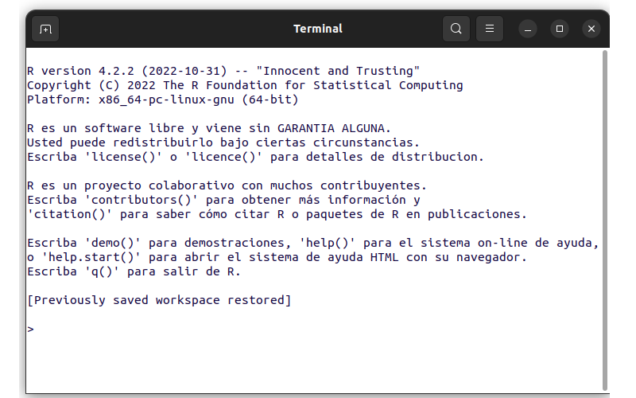
```

<br/>

## <span style="color:#034a94">**¿Qué es RStudio?**</span>

```{r, echo=FALSE, out.width="20%", fig.align="left"}
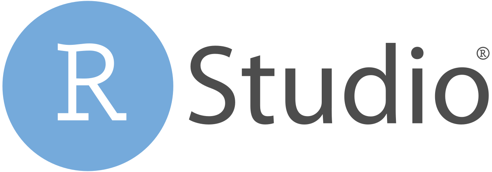
```

**RStudio** es un entorno de desarrollo integrado (IDE) creado por Posit, empresa antes llamada RStudio, que reúne en una sola interfaz las herramientas para trabajar con **R**. La edición de escritorio es [software de código abierto con licencia AGPL v3](https://docs.posit.co/ide/user/download.html) y su versión actual es la 2026.10.1.

Su interfaz tiene [cuatro paneles principales y una barra lateral opcional](https://docs.posit.co/ide/user/ide/guide/ui/ui-panes.html). En la siguiente figura se identifican sus componentes:

```{r fig-paneles, echo=FALSE, out.width="100%", fig.align="center", fig.cap="Paneles de RStudio. Fuente: adaptada de Posit, RStudio User Guide", fig.alt="Interfaz de RStudio con los nueve componentes numerados"}
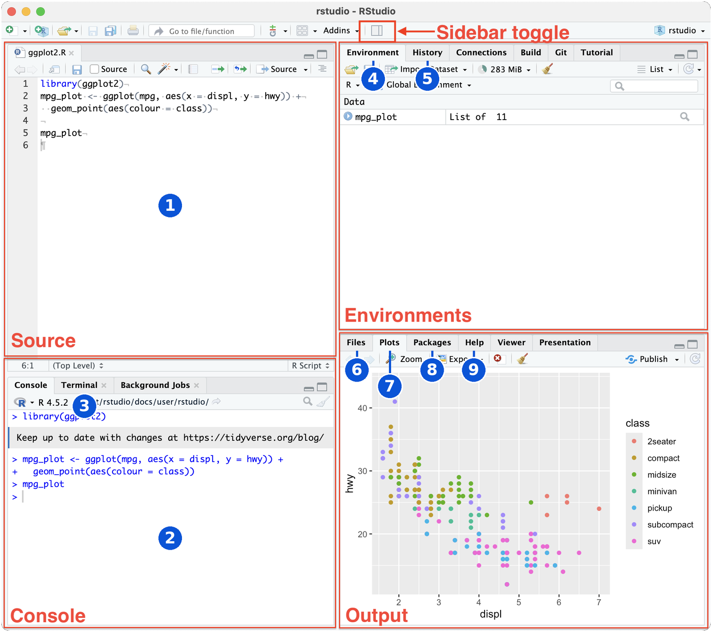
```

1. **Fuente (Source):** panel donde se editan y guardan scripts y otros archivos, como .R, .Rmd, .qmd, .py, .txt o .md.

    ```{r fig-fuente, echo=FALSE, out.width="100%", fig.align="center", fig.cap="Ubicación del panel Fuente (Source)", fig.alt="Ubicación del panel Fuente en RStudio"}
    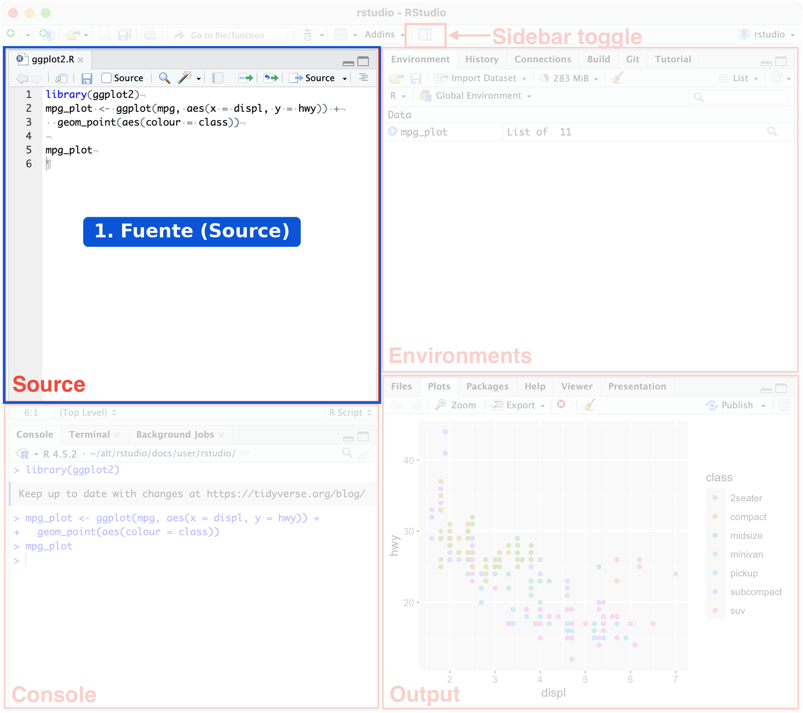
    ```

2. **Consola (Console):** panel donde se ejecuta código de forma interactiva. Por defecto usa R y, con el paquete `reticulate`, que conecta **R** con Python, también puede usar ese lenguaje.

    ```{r fig-consola, echo=FALSE, out.width="100%", fig.align="center", fig.cap="Ubicación del panel Consola (Console)", fig.alt="Ubicación del panel Consola en RStudio"}
    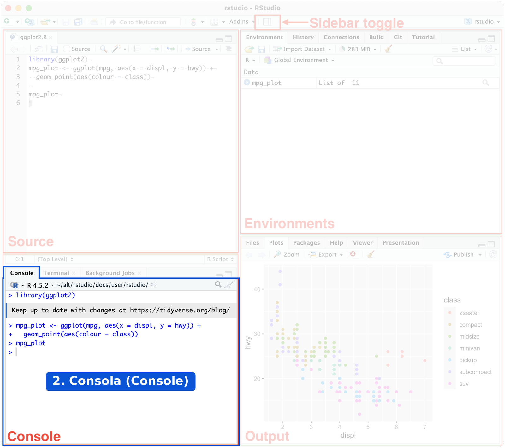
    ```

3. **Terminal:** pestaña del panel de consola para ejecutar comandos del sistema, entre ellos los de Git.

    ```{r fig-terminal, echo=FALSE, out.width="100%", fig.align="center", fig.cap="Ubicación de la pestaña Terminal", fig.alt="Ubicación de la pestaña Terminal en RStudio"}
    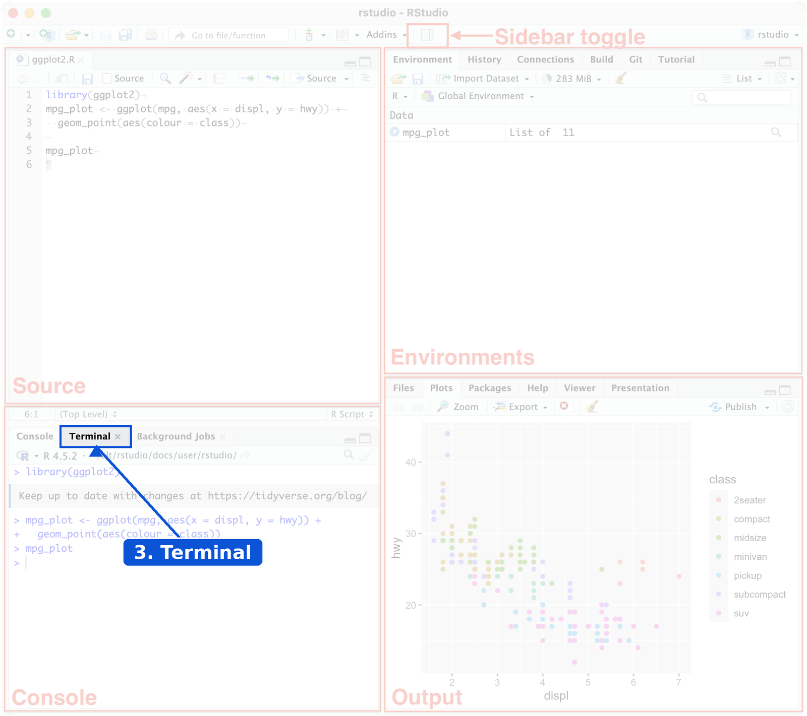
    ```

4. **Ambiente (Environment):** pestaña que muestra los objetos creados en la sesión y permite importar conjuntos de datos.

    ```{r fig-ambiente, echo=FALSE, out.width="100%", fig.align="center", fig.cap="Ubicación de la pestaña Ambiente (Environment)", fig.alt="Ubicación de la pestaña Ambiente en RStudio"}
    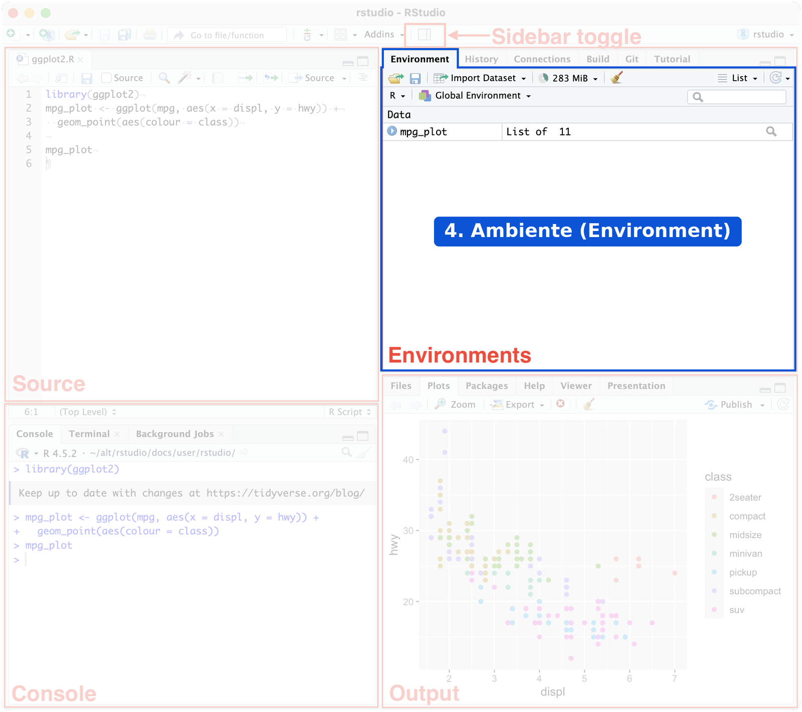
    ```

5. **Historial (History):** pestaña que registra los comandos ejecutados en la sesión.

    ```{r fig-historial, echo=FALSE, out.width="100%", fig.align="center", fig.cap="Ubicación de la pestaña Historial (History)", fig.alt="Ubicación de la pestaña Historial en RStudio"}
    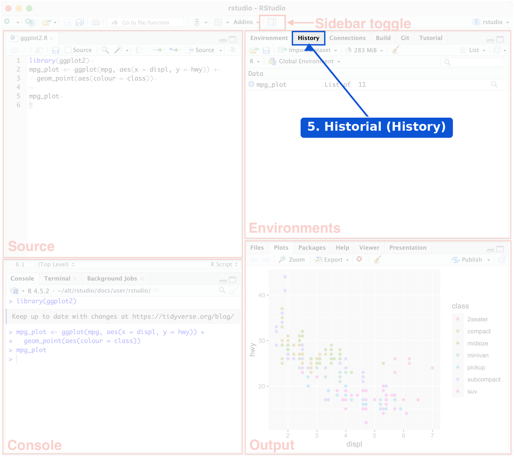
    ```

6. **Archivos (Files):** pestaña para explorar el proyecto y los directorios, y para crear, renombrar o eliminar archivos.

    ```{r fig-archivos, echo=FALSE, out.width="100%", fig.align="center", fig.cap="Ubicación de la pestaña Archivos (Files)", fig.alt="Ubicación de la pestaña Archivos en RStudio"}
    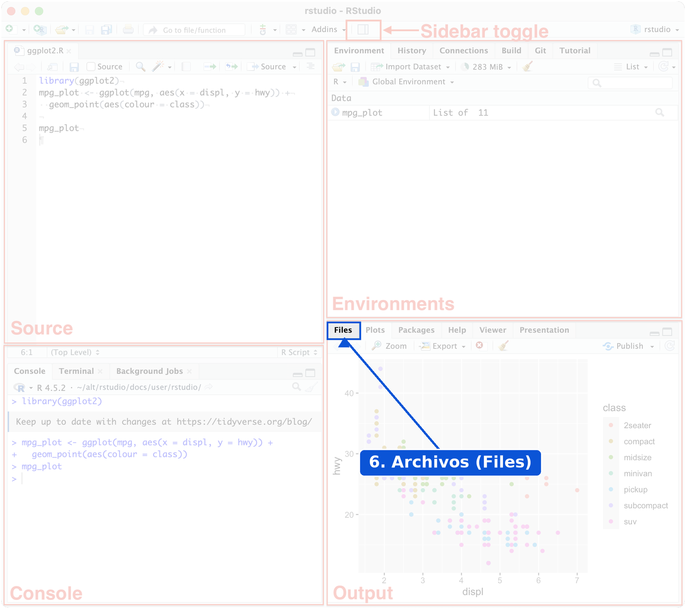
    ```

7. **Gráficos (Plots):** pestaña que presenta los gráficos generados y permite ampliarlos o exportarlos.

    ```{r fig-graficos, echo=FALSE, out.width="100%", fig.align="center", fig.cap="Ubicación de la pestaña Gráficos (Plots)", fig.alt="Ubicación de la pestaña Gráficos en RStudio"}
    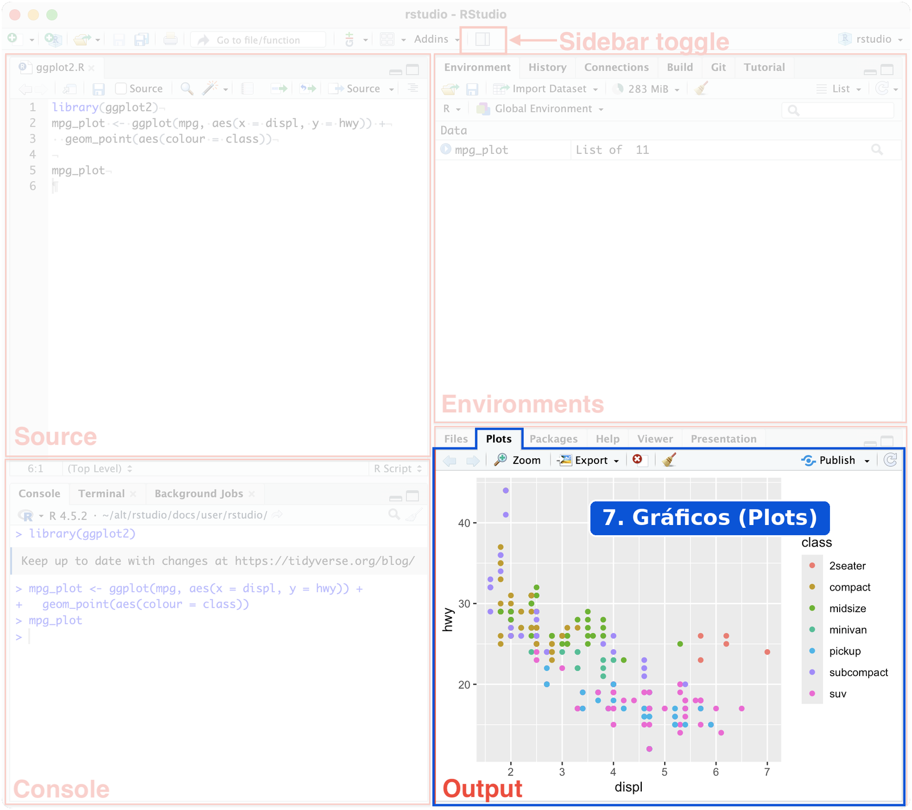
    ```

8. **Paquetes (Packages):** pestaña para consultar, instalar y actualizar paquetes.

    ```{r fig-paquetes, echo=FALSE, out.width="100%", fig.align="center", fig.cap="Ubicación de la pestaña Paquetes (Packages)", fig.alt="Ubicación de la pestaña Paquetes en RStudio"}
    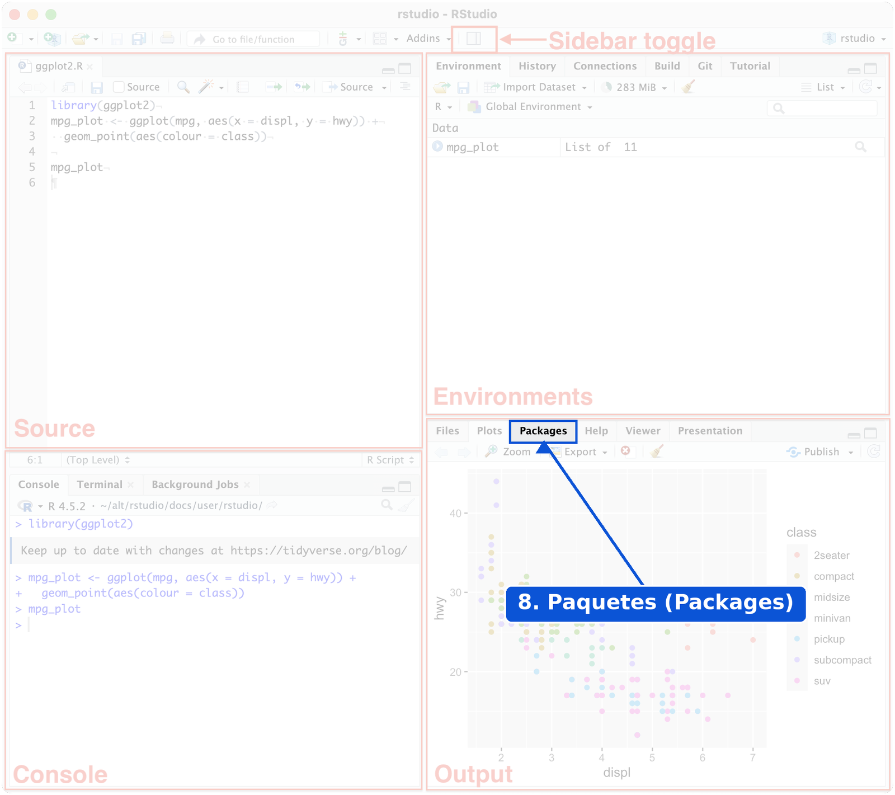
    ```

9. **Ayuda (Help):** pestaña que muestra la documentación y las viñetas de los paquetes.

    ```{r fig-ayuda, echo=FALSE, out.width="100%", fig.align="center", fig.cap="Ubicación de la pestaña Ayuda (Help)", fig.alt="Ubicación de la pestaña Ayuda en RStudio"}
    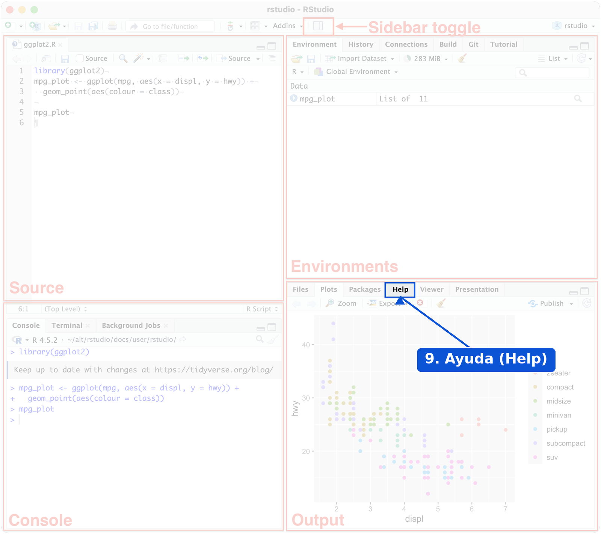
    ```

RStudio incluye además las pestañas Background Jobs, Connections, Build, Git, Tutorial, Viewer y Presentation. La disposición de los paneles se puede modificar en **Tools > Global Options > Pane Layout**.

<br/>

## <span style="color:#034a94">**¿Cómo instalar R y RStudio?**</span>

Primero se instala **R** y después **RStudio**, porque [RStudio necesita una instalación de R](https://docs.posit.co/ide/user/download.html). Los instaladores se descargan desde los siguientes enlaces:

- [Descargar R](https://cran.r-project.org/)

- [Descargar RStudio Desktop](https://docs.posit.co/ide/user/download.html)

**Nota.** Según Posit, en Windows [no se requiere nada más](https://docs.posit.co/ide/user/download.html) para ejecutar **RStudio**. Los siguientes programas son opcionales y dependen del trabajo que se vaya a realizar:

- **Git:** para el control de versiones desde **RStudio**.

- **LaTeX:** para generar archivos PDF. Se [recomienda TinyTeX](https://pkg.yihui.org/rmarkdown-cookbook/install-latex), aunque también sirven MiKTeX, MacTeX o TeX Live.

- **Python:** para trabajar con este lenguaje desde **RStudio**.

Desde la versión 2022.07.1, [RStudio permite editar y previsualizar documentos Quarto](https://docs.posit.co/ide/user/ide/guide/documents/quarto-project.html). Para generar informes con archivos Rmd se usa el paquete `rmarkdown`. TinyTeX se instala con cualquiera de estas dos opciones:

Desde la consola de **R**:

```{r, eval=FALSE}
install.packages("tinytex")
tinytex::install_tinytex()
```

Desde la terminal, si se trabaja con Quarto:

```bash
quarto install tinytex
```

<br/>

## <span style="color:#034a94">**¿Cómo pedir ayuda en R?**</span>

**R** cuenta con un sistema de ayuda que permite revisar la sintaxis y los argumentos de las funciones, además de ejemplos y referencias relacionadas. Se puede acceder desde la pestaña **Help** (número 9 de la figura de paneles) o desde la consola:

```{r, eval=FALSE}
help("lm")
```

```{r, eval=FALSE}
?lm
```

<br/>

## <span style="color:#034a94">**Errores frecuentes**</span>

| Problema                                  | Causa                                          | Solución                                       |
|:------------------------------------------|:-----------------------------------------------|:-----------------------------------------------|
| RStudio no abre o no encuentra **R**      | **R** no está instalado                        | Instalar **R** y abrir **RStudio** de nuevo    |
| `could not find function "Mean"`          | **R** distingue mayúsculas de minúsculas       | Escribir `mean()`                              |
| `unexpected ','`                          | Se usó coma como separador decimal             | Usar punto: `3.5`                              |
| La consola muestra `+` y no responde      | La instrucción está incompleta                 | Completarla o presionar **Esc**                |
| `No documentation for ...`                | El nombre de la función no existe o el paquete no está cargado | Revisar el nombre o usar `??palabra` |

<br/>

## <span style="color:#034a94">**Retos**</span>

<div class="content-box-yellow">
### <span style="color:#686868">**Reto 1. ¿Dónde se hace?**</span>

Indique en qué panel o pestaña de **RStudio** se hace cada tarea:

- Ver los objetos creados en la sesión.
- Escribir y guardar un script.
- Instalar un paquete sin escribir código.
- Consultar cómo funciona una función.

<details>
<summary>Ver solución</summary>

Los objetos se ven en **Environment**, el script se escribe en **Source**, los paquetes se instalan en **Packages** y la documentación se consulta en **Help**.

</details>
</div>

<div class="content-box-yellow">
### <span style="color:#686868">**Reto 2. Corrija las instrucciones**</span>

Cada línea tiene un error. Corríjala.

```{r, eval=FALSE}
Mean(c(1, 2, 3))
x <- 3,5
help(lm
```

<details>
<summary>Ver solución</summary>

```{r, eval=FALSE}
mean(c(1, 2, 3))    # R distingue mayúsculas de minúsculas
x <- 3.5            # el separador decimal es el punto
help(lm)            # faltaba cerrar el paréntesis
```

</details>
</div>

<div class="content-box-yellow">
### <span style="color:#686868">**Reto 3. Use la ayuda**</span>

Ejecute `?mean` y averigüe qué hace el argumento `trim`. ¿Qué resultado da `mean(c(1, 2, 3, 100), trim = 0.25)`? ¿Por qué es tan distinto de la media sin ese argumento?

<details>
<summary>Ver solución</summary>

`trim` indica la fracción de observaciones que se elimina en cada extremo antes de calcular la media. Aquí se quitan el 1 y el 100:

```{r}
mean(c(1, 2, 3, 100), trim = 0.25)
mean(c(1, 2, 3, 100))
```

La media sin ese argumento se ve afectada por el valor 100.

</details>
</div>

<br/>

## <span style="color:#034a94">**Libros y recursos**</span>

- [Big Book of R](https://www.bigbookofr.com/): colección de más de 400 libros sobre **R**, con una [sección en español](https://www.bigbookofr.com/chapters/Espa%C3%B1ol.html).

- [R para Ciencia de Datos, 2.ª edición](https://davidrsch.github.io/r4ds-es/): traducción al español de la edición vigente.

- [R para Ciencia de Datos, 1.ª edición](https://es.r4ds.hadley.nz/): traducción colaborativa de la comunidad latinoamericana de **R**.

- [Guía de usuario de RStudio](https://docs.posit.co/ide/user/): documentación oficial de Posit.

<br/>

## <span style="color:#034a94">**Referencias**</span>

- R Core Team. [What is R?](https://www.r-project.org/about.html) y [R Developer Page](https://developer.r-project.org/).

- CRAN. [Contributed Packages](https://cran.r-project.org/web/packages/).

- Bioconductor. [Release announcements](https://bioconductor.org/about/release-announcements/).

- Posit. [Download RStudio](https://docs.posit.co/ide/user/download.html), [Pane Layout](https://docs.posit.co/ide/user/ide/guide/ui/ui-panes.html) y [Quarto Integration](https://docs.posit.co/ide/user/ide/guide/documents/quarto-project.html).

- Ihaka, R. y Gentleman, R. (1996). R: A Language for Data Analysis and Graphics. *Journal of Computational and Graphical Statistics*, 5(3), 299-314. <https://doi.org/10.1080/10618600.1996.10474713>

- Xie, Y., Dervieux, C. y Riederer, E. [R Markdown Cookbook: Install LaTeX (TinyTeX)](https://pkg.yihui.org/rmarkdown-cookbook/install-latex).

- Wikipedia. [R (programming language)](https://en.wikipedia.org/wiki/R_(programming_language)).

- Slashdot. [Python Stays #1, R Rises in Popularity, Says TIOBE](https://slashdot.org/story/26/05/17/0252216/python-stays-1-r-rises-in-popularity-says-tiobe).

- Las figuras de los paneles de **RStudio** se adaptaron de la imagen de [Pane Layout](https://docs.posit.co/ide/user/ide/guide/ui/ui-panes.html), en la guía de usuario de **RStudio** de Posit.

<br/>

*Última revisión: 4 de noviembre de 2026.*

<br/><br/>
