```{r setup, include=FALSE}
knitr::opts_chunk$set(echo = TRUE, message = FALSE, warning = FALSE, comment = NA, collapse = TRUE)
```

<br/>

Analizar datos es solo una parte del trabajo: también hay que comunicar los resultados. Si el análisis se hace en un programa y el informe en otro, cada cambio en los datos obliga a copiar y pegar de nuevo tablas y gráficos, y es fácil cometer errores.

**RMarkdown** resuelve este problema: un solo archivo `.Rmd` reúne el texto, el código y sus resultados. Al generar el documento, el código se ejecuta de nuevo y los resultados se actualizan. Esto hace que el análisis sea **reproducible**: otra persona, o uno mismo tiempo después, puede repetirlo y obtener lo mismo.

<br/>

## <span style="color:#034a94">**¿Qué se necesita?**</span>

Según [R Markdown: The Definitive Guide](https://bookdown.org/yihui/rmarkdown/installation.html), para empezar se requiere:

- **R** y **RStudio**. RStudio ya incluye Pandoc, el programa que convierte los documentos de un formato a otro.
- El paquete `rmarkdown`, que convierte un archivo `.Rmd` en un documento final. **R** lo necesita para generar cualquier documento.
- **LaTeX**, el sistema que crea los PDF. Solo hace falta para generar ese formato. La forma más sencilla de instalarlo es con el paquete `tinytex`, que instala TinyTeX, una versión liviana de LaTeX.

```{r, eval=FALSE}
install.packages("rmarkdown")

# Solo para generar PDF
install.packages("tinytex")
tinytex::install_tinytex()
```

<br/>

## <span style="color:#034a94">**¿Cómo funciona?**</span>

Según la documentación del paquete `rmarkdown`, un documento se genera en dos etapas. Primero, el paquete `knitr` ejecuta el código y escribe sus resultados en el texto. Luego, Pandoc convierte ese texto al formato elegido.

```{r, echo=FALSE, out.width="100%", fig.align="center", fig.cap="Proceso para generar un documento desde un archivo .Rmd", fig.alt="Diagrama: el archivo Rmd pasa por knitr, se convierte en Markdown y Pandoc genera HTML, Word, PDF o presentaciones"}
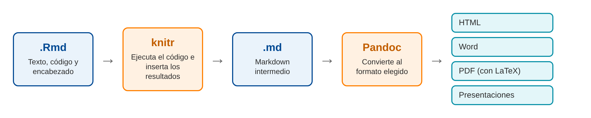
```

<br/>

## <span style="color:#034a94">**¿Cómo crear un documento?**</span>

### <span style="color:#034a94">**Paso 1. Crear el archivo**</span>

En **RStudio**, ingresar a **File > New File > R Markdown...**

```{r, echo=FALSE, out.width="70%", fig.align="center", fig.cap="Menú para crear un archivo R Markdown", fig.alt="Menú File, New File de RStudio con la opción R Markdown seleccionada"}
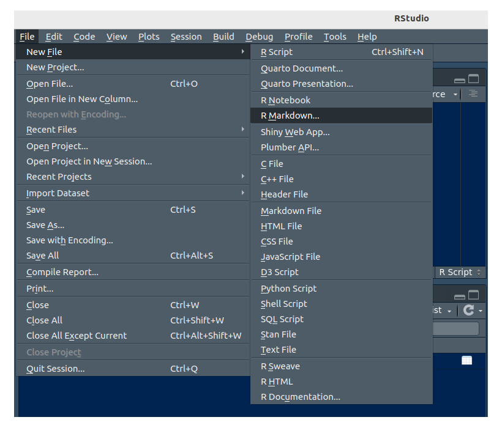
```

### <span style="color:#034a94">**Paso 2. Elegir título, autor y formato**</span>

En la ventana que aparece se escribe el título y el autor, y se elige el formato. Se recomienda empezar con **HTML**. El formato se puede cambiar después sin rehacer el documento.

```{r, echo=FALSE, out.width="70%", fig.align="center", fig.cap="Ventana New R Markdown", fig.alt="Ventana New R Markdown con campos de título, autor, fecha y las opciones HTML, PDF y Word"}
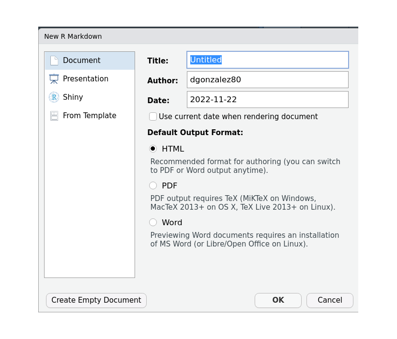
```

Al hacer clic en **OK**, RStudio abre una plantilla de ejemplo. Conviene guardarla de inmediato con extensión `.Rmd`, dentro del proyecto de **RStudio**.

### <span style="color:#034a94">**Paso 3. Escribir el contenido**</span>

Un archivo `.Rmd` tiene tres partes:

```{r, echo=FALSE, out.width="100%", fig.align="center", fig.cap="Partes de un archivo .Rmd", fig.alt="Ejemplo de archivo Rmd con el encabezado YAML, el texto en Markdown y un bloque de código resaltados"}
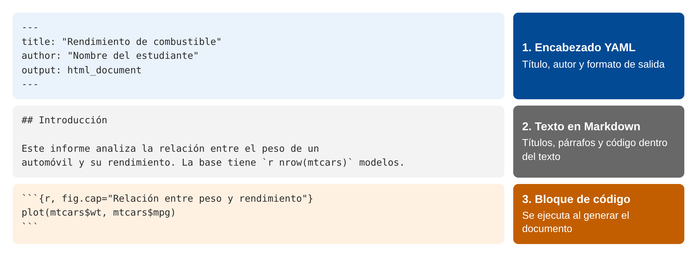
```

### <span style="color:#034a94">**Paso 4. Insertar código y generar el documento**</span>

Un bloque de código se inserta con el botón verde **C** o con **Ctrl + Alt + I** (**Cmd + Option + I** en macOS). Cada bloque se puede probar con el triángulo verde que aparece a su derecha.

Para generar el documento se usa el botón **Knit** o **Ctrl + Shift + K** (**Cmd + Shift + K** en macOS).

```{r, echo=FALSE, out.width="100%", fig.align="center", fig.cap="Botones para insertar código y generar el documento", fig.alt="Barra de herramientas de RStudio con los botones Knit e insertar bloque de código resaltados"}
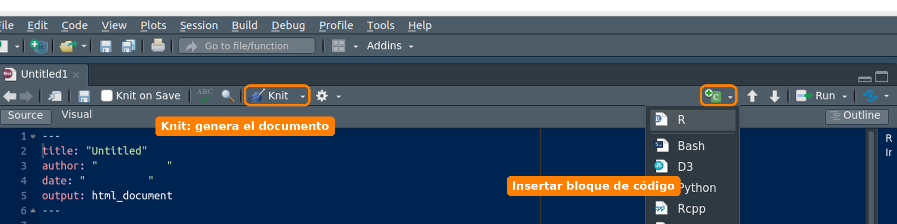
```

### <span style="color:#034a94">**Paso 5. Revisar el resultado**</span>

**RStudio** muestra el documento y guarda el archivo de salida en la misma carpeta del `.Rmd`. Este es el resultado del ejemplo de esta página:

```{r, echo=FALSE, out.width="75%", fig.align="center", fig.cap="Documento HTML generado", fig.alt="Documento HTML con título, texto, tabla y gráfico de dispersión"}
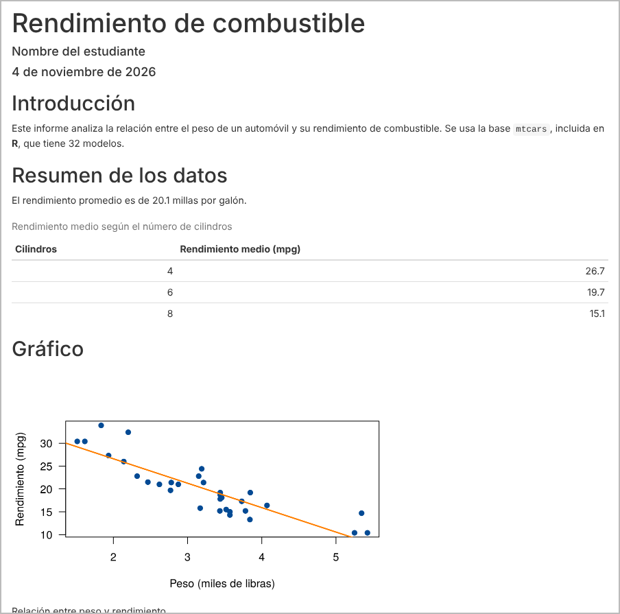
```

<div class="content-box-gray">
### <span style="color:#686868">**Ejemplo completo**</span>

<a href="data/ejemplo_rmarkdown.Rmd" download>Descargar ejemplo_rmarkdown.Rmd</a>. Ábralo en **RStudio** y haga clic en **Knit**.
</div>

Este es su contenido:

```{r, echo=FALSE, comment=""}
writeLines(readLines("data/ejemplo_rmarkdown.Rmd"))
```

<br/>

## <span style="color:#034a94">**¿Cómo escribir con Markdown?**</span>

Markdown es una forma simple de dar formato usando texto plano.

| Se escribe                    | Se obtiene                  |
|:------------------------------|:----------------------------|
| `# Título 1`                  | título de primer nivel      |
| `## Título 2`                 | título de segundo nivel     |
| `**negrita**`                 | **negrita**                 |
| `*cursiva*`                   | *cursiva*                   |
| `` `codigo` ``                | `codigo`                    |
| `- elemento`                  | lista con viñetas           |
| `1. elemento`                 | lista numerada              |
| `[Posit](https://posit.co)`   | [Posit](https://posit.co)   |
| `` | imagen                    |
| `$\bar{x}$`                   | $\bar{x}$                   |
| `$$s^2 = \frac{1}{n-1}\sum_{i=1}^{n}(x_i-\bar{x})^2$$` | ecuación centrada |

Una tabla se puede escribir directamente:

```
| Grupo | Promedio |
|:------|---------:|
| A     |      3.8 |
| B     |      4.1 |
```

<br/>

## <span style="color:#034a94">**¿Cómo incluir código y resultados?**</span>

### <span style="color:#034a94">**Bloques de código**</span>

Un bloque empieza con ` ```{r} ` y termina con ` ``` `. Se le puede dar un nombre y agregar opciones que controlan qué aparece en el documento:

| Opción                  | Qué hace                                        |
|:------------------------|:------------------------------------------------|
| `echo = FALSE`          | oculta el código y muestra el resultado         |
| `eval = FALSE`          | muestra el código sin ejecutarlo                |
| `include = FALSE`       | ejecuta el código sin mostrar nada              |
| `message = FALSE`       | oculta los mensajes                             |
| `warning = FALSE`       | oculta las advertencias                         |
| `fig.cap = "Título"`    | agrega un título a la figura                    |
| `fig.width`, `fig.height` | define el tamaño de la figura, en pulgadas    |
| `cache = TRUE`          | guarda el resultado para no recalcularlo        |

Las opciones que se repiten se definen una sola vez en el primer bloque:

```{r, eval=FALSE}
knitr::opts_chunk$set(echo = FALSE, message = FALSE, warning = FALSE)
```

### <span style="color:#034a94">**Código dentro del texto**</span>

Un resultado también se puede insertar en una oración. Así, al escribir

<pre>
La base tiene `r knitr::inline_expr("nrow(mtcars)")` modelos.
</pre>

se obtiene: La base tiene `r nrow(mtcars)` modelos. De esta forma las cifras del texto se actualizan solas si cambian los datos.

### <span style="color:#034a94">**Tablas**</span>

La función `kable()`, del paquete `knitr`, convierte un data frame en una tabla con formato. El paquete `knitr` se instala junto con `rmarkdown`. Se escribe `knitr::kable()` para usar la función sin cargar todo el paquete con `library()`:

```{r}
knitr::kable(head(iris, 3), caption = "Primeros registros de la base iris")
```

<br/>

## <span style="color:#034a94">**¿Qué tipos de documento se pueden generar?**</span>

El formato se define en el campo `output` del encabezado. El paquete `rmarkdown` incluye los siguientes:

| Tipo          | Valor de `output`         | Genera                 | Requiere                 |
|:--------------|:--------------------------|:-----------------------|:-------------------------|
| Documento     | `html_document`           | página web             |                          |
|               | `pdf_document`            | PDF                    | LaTeX                    |
|               | `word_document`           | Word (.docx)           | Word o LibreOffice para abrirlo |
|               | `odt_document`            | OpenDocument (.odt)    |                          |
|               | `rtf_document`            | texto enriquecido (.rtf) |                        |
|               | `md_document`             | Markdown               |                          |
|               | `github_document`         | Markdown para GitHub   |                          |
| Cuaderno      | `html_notebook`           | cuaderno interactivo   |                          |
| Presentación  | `ioslides_presentation`   | diapositivas HTML      |                          |
|               | `slidy_presentation`      | diapositivas HTML      |                          |
|               | `beamer_presentation`     | diapositivas PDF       | LaTeX                    |
|               | `powerpoint_presentation` | PowerPoint (.pptx)     | PowerPoint o LibreOffice para abrirlo |

### <span style="color:#034a94">**Un mismo archivo, varios formatos**</span>

Estas imágenes salieron del mismo archivo `ejemplo_rmarkdown.Rmd`. Solo cambió el valor de `output`.

<div class="row">
<div class="col-sm-6">
```{r, echo=FALSE, out.width="100%", fig.cap="pdf_document", fig.alt="Página del ejemplo en PDF"}
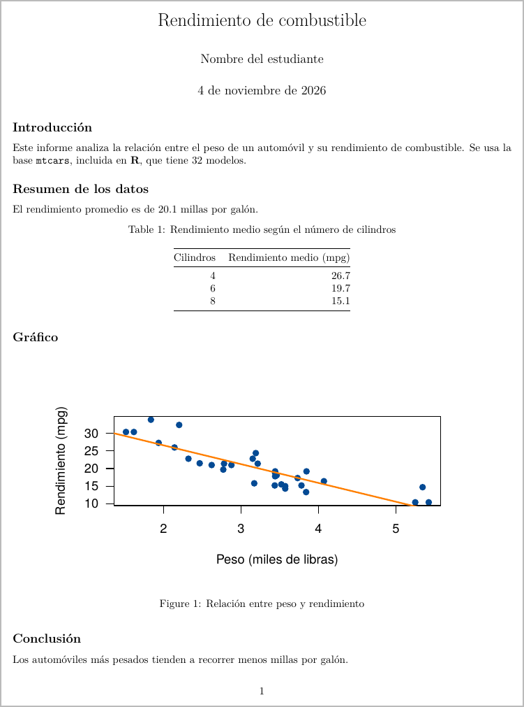
```
</div>
<div class="col-sm-6">
```{r, echo=FALSE, out.width="100%", fig.cap="word_document", fig.alt="Página del ejemplo en Word"}
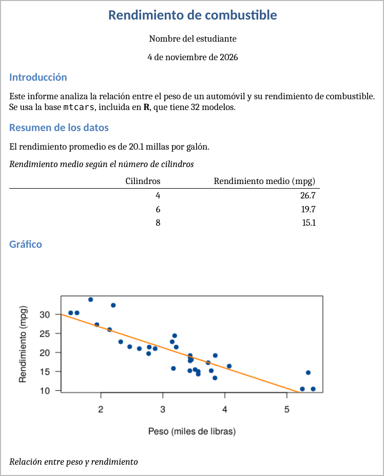
```
</div>
</div>

<div class="row">
<div class="col-sm-6">
```{r, echo=FALSE, out.width="100%", fig.cap="beamer_presentation", fig.alt="Diapositiva del ejemplo en Beamer"}
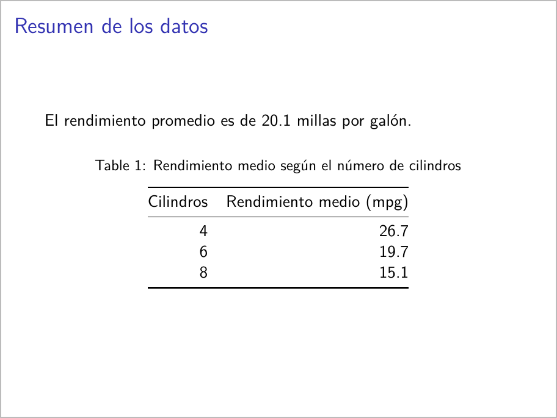
```
</div>
<div class="col-sm-6">
```{r, echo=FALSE, out.width="100%", fig.cap="powerpoint_presentation", fig.alt="Diapositiva del ejemplo en PowerPoint"}
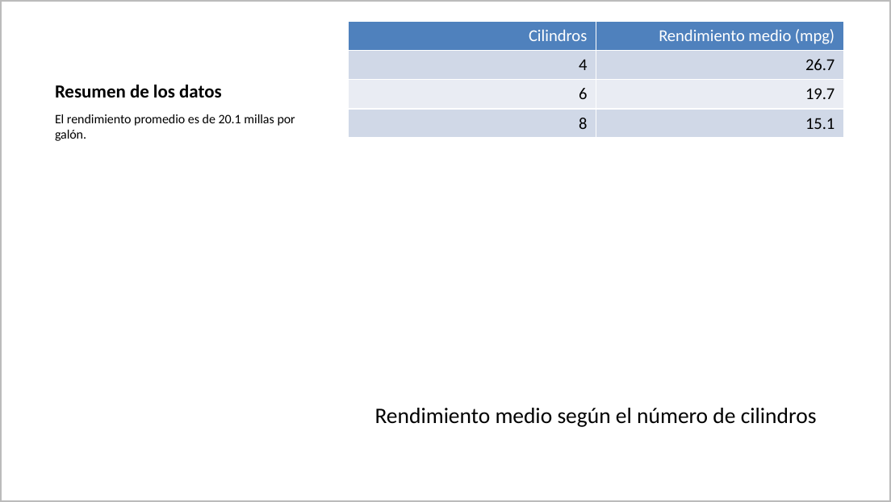
```
</div>
</div>

```{r, echo=FALSE, out.width="60%", fig.align="center", fig.cap="slidy_presentation", fig.alt="Diapositiva del ejemplo en Slidy"}
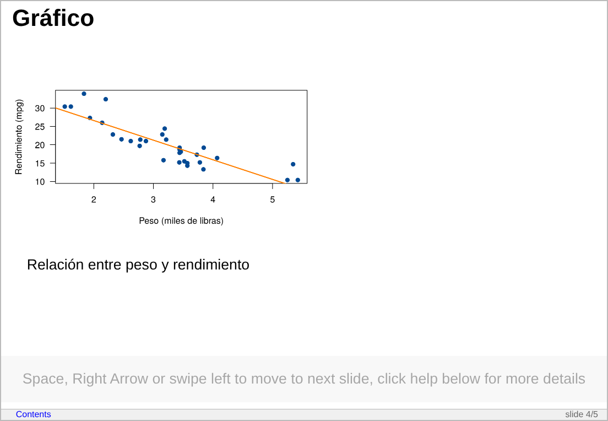
```

En las presentaciones, cada título `##` inicia una diapositiva.

### <span style="color:#034a94">**Opciones del encabezado**</span>

Cada formato admite opciones. Por ejemplo, este encabezado agrega una tabla de contenido, numera las secciones y permite ocultar el código:

```
---
title: "Mi informe"
author: "Nombre"
output:
  html_document:
    toc: true
    toc_float: true
    number_sections: true
    code_folding: hide
---
```

### <span style="color:#034a94">**Otros documentos con paquetes adicionales**</span>

Con otros paquetes se pueden crear [más tipos de documento](https://bookdown.org/yihui/rmarkdown/). Cada uno se instala con `install.packages()` y agrega sus plantillas a **File > New File > R Markdown > From Template**.

| Paquete         | Para qué sirve                                                       | Ejemplo de uso                         |
|:----------------|:---------------------------------------------------------------------|:---------------------------------------|
| `flexdashboard` | Organiza gráficos e indicadores en un tablero                        | Seguimiento mensual de ventas          |
| `bookdown`      | Escribe documentos largos con capítulos y referencias cruzadas       | Libro, tesis o manual                  |
| `blogdown`      | Crea sitios web y blogs                                              | Página personal con publicaciones      |
| `rticles`       | Ofrece plantillas con el formato de revistas científicas             | Artículo para enviar a una revista     |
| `xaringan`      | Crea presentaciones HTML con más opciones de diseño                  | Clase o sustentación                   |
| `revealjs`      | Crea presentaciones HTML con transiciones                            | Charla o conferencia                   |
| `learnr`        | Convierte un documento en un tutorial con ejercicios                 | Material de práctica para estudiantes  |
| `shiny`         | Agrega controles que el lector puede cambiar                         | Aplicación para explorar datos         |
| `tufte`         | Da formato de documento con notas al margen                          | Informe con comentarios laterales      |

Este sitio no necesita un paquete adicional: se construye con `rmarkdown::render_site()`, que convierte varios `.Rmd` en un sitio web.

### <span style="color:#034a94">**Informes con parámetros**</span>

Un mismo informe se puede repetir para distintos casos. Los parámetros se definen en el encabezado y se usan en el código como `params$ciudad`:

```
---
title: "Informe por ciudad"
output: html_document
params:
  ciudad: "Cali"
---
```

```{r, eval=FALSE}
rmarkdown::render("informe.Rmd", params = list(ciudad = "Pasto"))
```

<br/>

## <span style="color:#034a94">**¿Qué diferencia hay entre RMarkdown y Quarto?**</span>

[Quarto](https://quarto.org/) es el sistema de publicación más reciente, creado también por Posit. Funciona con R, Python y Julia, y usa archivos `.qmd` con una sintaxis muy parecida. Se elige desde **File > New File > Quarto Document...** y el formato se indica con `format: html`.

RMarkdown [sigue con mantenimiento y soporte](https://blog.jumpingrivers.com/blog/quarto-rmarkdown-comparison/), de modo que no es obligatorio migrar. Lo aprendido en esta página sirve para ambos.

<br/>

## <span style="color:#034a94">**Errores frecuentes**</span>

| Problema                                | Causa                                                 | Solución                                       |
|:----------------------------------------|:------------------------------------------------------|:-----------------------------------------------|
| Funciona en la consola, pero Knit falla con `object not found` | Knit trabaja en una sesión nueva y no ve los objetos del ambiente | Crear o cargar los objetos dentro del `.Rmd`   |
| `could not find function`               | Falta cargar un paquete                               | Agregar `library()` en un bloque               |
| `cannot open file`                      | La ruta no es relativa a la carpeta del `.Rmd`        | Usar proyectos y rutas relativas               |
| El PDF no se genera                     | No hay LaTeX instalado                                | Instalar TinyTeX                               |
| `duplicate label`                       | Dos bloques tienen el mismo nombre                    | Cambiar uno de los nombres                     |
| Error con `install.packages()`          | Se dejó esa instrucción en un bloque                  | Instalar en la consola, una sola vez           |
| El documento se corta o se ve mal       | Falta cerrar un bloque con ` ``` `                    | Revisar el cierre de cada bloque               |

<br/>

## <span style="color:#034a94">**Retos**</span>

<div class="content-box-yellow">
### <span style="color:#686868">**Reto 1. Un archivo, dos formatos**</span>

Descargue `ejemplo_rmarkdown.Rmd`, ábralo en **RStudio** y genere el documento. Después obtenga una versión en Word sin cambiar el contenido.

<details>
<summary>Ver solución</summary>

En el encabezado, cambie `output: html_document` por `output: word_document` y haga clic en **Knit**. El archivo `.docx` queda en la misma carpeta del `.Rmd`.

</details>
</div>

<div class="content-box-yellow">
### <span style="color:#686868">**Reto 2. Su primer informe**</span>

Cree un documento HTML con la base `iris` que incluya título, autor, una tabla con la media de `Sepal.Length` por especie, un gráfico y una oración cuya cifra se calcule con código dentro del texto.

<details>
<summary>Ver solución</summary>

Esta es una solución posible:

```{r, echo=FALSE, comment=""}
writeLines(readLines("data/solucion_iris.Rmd"))
```

</details>
</div>

<div class="content-box-yellow">
### <span style="color:#686868">**Reto 3. Un informe para otro lector**</span>

Modifique el informe del reto anterior para que tenga tabla de contenido y no muestre el código ni los mensajes. Luego elimine las filas de la especie `setosa` y compruebe que las cifras del texto se actualizan solas.

<details>
<summary>Ver solución</summary>

La tabla de contenido se activa en el encabezado:

```
output:
  html_document:
    toc: true
```

El código y los mensajes se ocultan en el primer bloque. Allí mismo se pueden cambiar los datos, y los demás bloques deben usar `datos` en lugar de `iris`:

```{r, eval=FALSE}
knitr::opts_chunk$set(echo = FALSE, message = FALSE, warning = FALSE)
datos <- subset(iris, Species != "setosa")
```

Al generar de nuevo el documento, la oración indica 100 flores en lugar de 150.

</details>
</div>

<div class="content-box-yellow">
### <span style="color:#686868">**Reto 4. Funciona en la consola, pero no en Knit**</span>

Una persona ejecuta `datos <- iris` en la consola. Su archivo `.Rmd` solo tiene un bloque con `summary(datos)`. Al hacer clic en **Knit** aparece el error `object 'datos' not found`. ¿Qué pasó y cómo se corrige?

<details>
<summary>Ver solución</summary>

**Knit** trabaja en una sesión nueva y no ve los objetos creados en la consola. Se debe crear el objeto dentro del `.Rmd`, antes de usarlo:

```{r, eval=FALSE}
datos <- iris
summary(datos)
```

</details>
</div>

<br/>

## <span style="color:#034a94">**Libros y recursos**</span>

### <span style="color:#034a94">**Libros gratuitos en línea**</span>

- Xie, Y., Allaire, J. J. y Grolemund, G. (2018). [R Markdown: The Definitive Guide](https://bookdown.org/yihui/rmarkdown/). Chapman & Hall/CRC. Es la guía completa.
- Xie, Y., Dervieux, C. y Riederer, E. (2020). [R Markdown Cookbook](https://bookdown.org/yihui/rmarkdown-cookbook/). Chapman & Hall/CRC. Reúne soluciones prácticas a tareas concretas.
- Wickham, H., Çetinkaya-Rundel, M. y Grolemund, G. (2023). [R para Ciencia de Datos](https://davidrsch.github.io/r4ds-es/) (2.ª ed., traducción al español). La parte de comunicación trata Quarto.
- Xie, Y. [bookdown: Authoring Books and Technical Documents with R Markdown](https://bookdown.org/yihui/bookdown/). Explica cómo escribir libros y documentos largos.

### <span style="color:#034a94">**Otros libros**</span>

- Xie, Y. (2015). *Dynamic Documents with R and knitr* (2.ª ed.). Chapman & Hall/CRC.
- Gandrud, C. (2020). *Reproducible Research with R and RStudio* (3.ª ed.). Chapman & Hall/CRC.

### <span style="color:#034a94">**Recursos oficiales**</span>

- [Sitio de R Markdown](https://rmarkdown.rstudio.com/), con tutoriales.
- [Galería de R Markdown](https://rmarkdown.rstudio.com/gallery.html), con ejemplos de documentos.
- [Hojas de referencia de Posit](https://rstudio.github.io/cheatsheets/), con traducciones al español.
- [Guía de Quarto](https://quarto.org/docs/guide/).

### <span style="color:#034a94">**Videos**</span>

Estos videos en español complementan la página. Algunos son de hace varios años, así que la apariencia de **RStudio** puede variar.

| Video                                              | Canal                  | Año  | Tema                                   |
|:---------------------------------------------------|:-----------------------|:-----|:---------------------------------------|
| [Aprende lo Básico de R Markdown en 20 Minutos](https://www.youtube.com/watch?v=6Qj8yBFgT9Q) | José Antonio: Estadística Aplicada | 2021 | Introducción                           |
| [Videotutorial 3. RMarkdown para principiantes](https://www.youtube.com/watch?v=V0eJE55aTrY) | Máxima Formación       | 2018 | Documentos reproducibles               |
| [Aspectos básicos de R Markdown](https://www.youtube.com/watch?v=H6DXz3m0ZN4) | DaniMedi               | 2020 | Crear el archivo y sintaxis básica     |
| [Incluyendo código en R Markdown (chunks)](https://www.youtube.com/watch?v=_ei3eTTg8tU) | DaniMedi               | 2020 | Bloques de código y opciones           |
| [Generar documento PDF en RMarkdown](https://www.youtube.com/watch?v=F2oeQmKCzNw) | Renzo Caceres Rossi    | 2022 | PDF e índice                           |
| [R markdown en Rstudio: documentos y presentaciones](https://www.youtube.com/watch?v=C6Xuimk7p8A) | YenLab                 | 2022 | Clase completa, incluye `xaringan`     |

En inglés: [Quarto for the curious](https://posit.co/resources/videos/quarto-for-rmarkdown-users), de Tom Mock (Posit, 2022), compara RMarkdown y Quarto.

<br/>

## <span style="color:#034a94">**Referencias**</span>

- Xie, Y., Allaire, J. J. y Grolemund, G. [Installation](https://bookdown.org/yihui/rmarkdown/installation.html), en *R Markdown: The Definitive Guide*.
- Autores del paquete `rmarkdown`. Documentación del paquete y de la función `render()`.
- Jumping Rivers. [Quarto vs R Markdown](https://blog.jumpingrivers.com/blog/quarto-rmarkdown-comparison/).
- Las imágenes de los formatos de salida se generaron con el archivo de ejemplo de esta página.

<br/>

*Última revisión: 4 de noviembre de 2026.*

<br/><br/>
