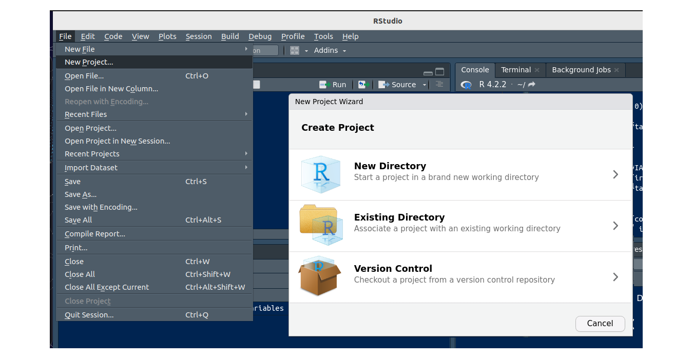

```{r setup, include=FALSE}
knitr::opts_chunk$set(echo = TRUE, message = FALSE, warning = FALSE, comment = NA, collapse = TRUE)
```

<br/>

Un análisis reúne datos, código, gráficos e informes. Si esos archivos quedan repartidos en varias carpetas, es fácil perderlos o que el código deje de funcionar al cambiar de computador. Un **proyecto de RStudio** [agrupa todos los archivos de un trabajo](https://docs.posit.co/ide/user/ide/guide/code/projects.html) en una sola carpeta, con su propio directorio de trabajo, historial y documentos abiertos.

<br/>

## <span style="color:#034a94">**¿Cómo crear un proyecto?**</span>

Se ingresa por **File > New Project** y se elige una de [tres opciones](https://docs.posit.co/ide/user/ide/guide/code/projects.html):

- **New Directory:** crea el proyecto en una carpeta nueva.
- **Existing Directory:** convierte en proyecto una carpeta que ya existe.
- **Version Control:** crea el proyecto clonando un repositorio, por ejemplo de GitHub.

```{r, echo=FALSE, out.width="100%", fig.align="center", fig.cap="Ventana para crear un proyecto en RStudio", fig.alt="Menú File con New Project y ventana con las opciones New Directory, Existing Directory y Version Control"}

```

<br/>

## <span style="color:#034a94">**¿Qué contiene un proyecto?**</span>

Al crearlo, **RStudio** agrega estos archivos a la carpeta:

| Archivo      | Para qué sirve                                                                          |
|:-------------|:----------------------------------------------------------------------------------------|
| `.Rproj`     | Guarda las opciones del proyecto y sirve de acceso directo para abrirlo                 |
| `.Rproj.user`| Carpeta oculta con archivos temporales, como autoguardados y el estado de las ventanas  |
| `.Rhistory`  | Historial de comandos                                                                   |
| `.RData`     | Objetos guardados de la sesión, si las opciones lo indican                              |

Según la [documentación de Posit](https://docs.posit.co/ide/user/ide/guide/code/projects.html), al abrir un proyecto se inicia una sesión nueva de **R**, el directorio de trabajo pasa a ser la carpeta del proyecto y se restauran los documentos abiertos.

Una forma directa de abrirlo es hacer doble clic en el archivo `.Rproj`. También se puede usar **File > Open Project**. Para trabajar en dos proyectos a la vez, cada uno se abre en su propia ventana con **File > Open Project in New Session**.

<br/>

## <span style="color:#034a94">**¿Cómo usar un proyecto?**</span>

1. Cree el proyecto con **File > New Project > New Directory > New Project** y llámelo `Actividad1`.

2. Cree un script con **File > New File > R Script** y guárdelo como `01-lectura.R`. Quedará dentro de la carpeta del proyecto.

3. En la carpeta del proyecto, cree el archivo de texto `datos.txt` con este contenido:

    ```
    variable1
    3
    4
    5
    6
    7
    ```

4. En el script escriba la siguiente instrucción y ejecútela con **Ctrl + Enter** (**Cmd + Enter** en macOS):

    ```{r, eval=FALSE}
    read.table("datos.txt", header = TRUE)
    ```

5. Compruebe el contenido del proyecto con `dir()`. Debe mostrar `01-lectura.R`, `Actividad1.Rproj` y `datos.txt`.

6. Cierre **RStudio**, mueva la carpeta `Actividad1` a otro lugar y abra `Actividad1.Rproj` con doble clic. El código sigue funcionando sin cambios, porque la ruta es relativa a la carpeta del proyecto.

<br/>

## <span style="color:#034a94">**¿Cómo organizar las carpetas?**</span>

No existe una única estructura correcta, pero separar los archivos por función ayuda mucho. Esta es una organización sencilla:

```
proyecto_ventas/
├── proyecto_ventas.Rproj
├── README.txt            descripción del proyecto
├── informe.Rmd           documento final
├── data/                 datos originales, no se modifican a mano
│   └── ventas.csv
├── R/                    scripts
│   └── 01-resumen.R
└── output/               tablas y gráficos generados
```

<a href="data/proyecto_ventas.zip" download>Descargar este proyecto de ejemplo</a> (los datos son ficticios).

### <span style="color:#034a94">**Nombres de archivos**</span>

[R para Ciencia de Datos](https://davidrsch.github.io/r4ds-es/) recomienda nombres descriptivos, sin espacios ni caracteres especiales. Si los scripts se ejecutan en un orden, conviene iniciar el nombre con un número.

| Evitar                     | Preferir                  |
|:---------------------------|:--------------------------|
| `Untitled1.R`              | `01-limpieza.R`           |
| `codigo final (2).R`       | `02-modelo.R`             |
| `Copia de datos nuevos.xlsx` | `ventas_2026.xlsx`      |

<br/>

## <span style="color:#034a94">**¿Qué son el directorio de trabajo y las rutas?**</span>

El **directorio de trabajo** es la carpeta donde **R** busca y guarda archivos. Se consulta con `getwd()`, y en un proyecto es la carpeta del proyecto.

Una **ruta** indica dónde está un archivo:

| Tipo     | Ejemplo                                      | ¿Funciona en otro computador? |
|:---------|:---------------------------------------------|:------------------------------|
| Absoluta | `"C:/Users/Ana/Documentos/curso/data/ventas.csv"` | No                       |
| Relativa | `"data/ventas.csv"`                          | Sí, dentro del proyecto       |

Por eso se recomienda [usar rutas relativas](https://tidyverse.org/blog/2017/12/workflow-vs-script/) y evitar `setwd()`: una ruta propia de un computador casi nunca funciona en otro.

```{r}
ventas <- read.csv("data/ventas.csv")
head(ventas, 3)
```

La función `file.path()` construye rutas con la barra correcta:

```{r}
file.path("data", "ventas.csv")
```

<div class="content-box-gray">
### <span style="color:#686868">**Cuidado en Windows**</span>

Windows muestra las rutas con `\`, pero en **R** esa barra tiene otro significado. Se debe [escribir `/`](https://r4ds.hadley.nz/workflow-scripts.html), que funciona en todos los sistemas.
</div>

```{r, error=TRUE}
ruta <- "C:\Users\Ana\ventas.csv"
```

### <span style="color:#034a94">**El paquete here**</span>

**¿Qué problema resuelve?** Una ruta relativa depende de la carpeta desde donde se ejecuta el archivo. En el proyecto de ejemplo, `"data/ventas.csv"` funciona si `informe.Rmd` está en la carpeta principal. Pero si ese informe se mueve a una subcarpeta llamada `informes`, **R** busca `informes/data/ventas.csv`, que no existe, y aparece un error.

**¿Qué hace?** La función `here()` ubica primero la carpeta principal del proyecto, identificada por el archivo `.Rproj`, y arma la ruta desde allí. Por eso la misma instrucción sirve desde cualquier subcarpeta y en cualquier computador.

| Ubicación del archivo que lee los datos | Ruta normal                      | Con `here()`                  |
|:----------------------------------------|:---------------------------------|:------------------------------|
| Carpeta principal                       | `"data/ventas.csv"`              | `here("data", "ventas.csv")`  |
| Subcarpeta `informes`                   | `"../data/ventas.csv"`           | `here("data", "ventas.csv")`  |

**¿Cómo se usa?** Se instala una sola vez, se carga con `library()` y se escribe cada carpeta y el archivo como textos separados por comas:

```{r, eval=FALSE}
install.packages("here")    # solo la primera vez

library(here)
ventas <- read.csv(here("data", "ventas.csv"))
```

En el computador de Ana, `here("data", "ventas.csv")` podría devolver `C:/Users/Ana/proyecto_ventas/data/ventas.csv`. En otro computador devolverá la ruta que corresponda, sin cambiar el código.

**¿Cuándo usarlo?** Cuando los archivos `.Rmd` o los scripts estén en distintas subcarpetas. Si todo se ejecuta desde la carpeta principal, las rutas relativas son suficientes y `here` no es necesario.

<br/>

## <span style="color:#034a94">**¿Cómo trabajar desde cero?**</span>

El análisis debe quedar en el código, no en la memoria de la sesión. Si un objeto solo existe en el ambiente, se perderá al cerrar **R** o será imposible saber cómo se creó. Para evitarlo se recomienda:

1. **Empezar cada sesión vacía.** En **Tools > Global Options > General**, desmarcar **Restore .RData into workspace at startup** y elegir **Never** en **Save workspace to .RData on exit**. Así, **R** no recupera objetos de sesiones anteriores.

2. **Comprobar que el script funciona solo.** Reiniciar **R** con **Ctrl + Shift + F10** (**Cmd + Shift + F10** en macOS) y ejecutar todo el script con **Ctrl + Shift + S** (**Cmd + Shift + S** en macOS). Si algo falla, al script le falta una instrucción. Esta práctica la [recomienda R para Ciencia de Datos](https://r4ds.hadley.nz/workflow-scripts.html).

3. **Cargar los paquetes al inicio del script.** Quien lo reciba verá de inmediato qué necesita. La instrucción `install.packages()` se ejecuta en la consola y no se deja en el código que se comparte, porque instalaría programas en el computador de otra persona.

<div class="content-box-gray">
### <span style="color:#686868">**Dos hábitos que conviene evitar**</span>

Según [Jenny Bryan (2017)](https://tidyverse.org/blog/2017/12/workflow-vs-script/):

- `setwd("C:/...")` hace que el código dependa de un computador.
- `rm(list = ls())` no deja una sesión limpia: borra los objetos, pero los paquetes cargados y las opciones siguen activos. Lo correcto es reiniciar **R**.
</div>

<br/>

## <span style="color:#034a94">**¿Cómo usar RMarkdown en un proyecto?**</span>

Al generar un documento, las rutas de un `.Rmd` se calculan desde la carpeta donde está ese archivo. Si `informe.Rmd` está en la carpeta principal, `"data/ventas.csv"` funciona. Si se mueve a una subcarpeta, esa ruta falla y hay que usar `"../data/ventas.csv"` o `here()`. La página [RMarkdown](recurso102.html) explica cómo crear estos documentos.

<br/>

## <span style="color:#034a94">**¿Cómo conservar las versiones de los paquetes?**</span>

**¿Qué problema resuelve?** Un proyecto separa los archivos, pero **no** separa los paquetes: por defecto, todos los proyectos usan los mismos paquetes instalados en el computador. Si dentro de un año se actualiza un paquete, un análisis de hoy podría dar otro resultado o dejar de funcionar. Lo mismo puede ocurrir si otra persona lo ejecuta con versiones distintas.

**¿Qué hace?** El paquete [`renv`](https://rstudio.github.io/renv/articles/renv.html) le da a cada proyecto su propia colección de paquetes y anota sus versiones en un archivo llamado `renv.lock`. Con esa lista, otra persona puede instalar exactamente las mismas versiones.

**¿Cómo se usa?**

| Instrucción        | Cuándo se ejecuta                                    | Qué hace                                          |
|:-------------------|:-----------------------------------------------------|:--------------------------------------------------|
| `renv::init()`     | Una vez, al empezar                                  | Activa `renv` en el proyecto y crea `renv.lock`   |
| `renv::snapshot()` | Después de instalar o actualizar paquetes            | Guarda las versiones actuales en `renv.lock`      |
| `renv::restore()`  | Al abrir el proyecto en otro computador              | Instala las versiones anotadas en `renv.lock`     |

```{r, eval=FALSE}
install.packages("renv")    # solo la primera vez

renv::init()
```

**¿Cuándo usarlo?** En trabajos largos, compartidos o que deban repetirse en el futuro, como una tesis. No es necesario en esta unidad.

<br/>

## <span style="color:#034a94">**¿Qué es el control de versiones con Git?**</span>

**Git** guarda el historial de cambios de un proyecto, y **GitHub** permite compartirlo. La opción **Version Control** crea un proyecto a partir de un repositorio. Es útil para colaborar y para recuperar versiones anteriores, pero no se requiere en esta unidad. El libro [Happy Git and GitHub for the useR](https://happygitwithr.com/) es una buena guía para empezar.

<br/>

## <span style="color:#034a94">**¿Qué requisitos deben cumplir las entregas?**</span>

<div class="content-box-gray">
### <span style="color:#686868">**Requerimientos**</span>

Todas las actividades evaluativas de esta asignatura deben desarrollarse con **R** y **RStudio**, y presentarse en **formato HTML** generado con **RMarkdown**. Para cada actividad se debe crear un proyecto y enviar un archivo comprimido (`.zip`) que contenga:

- El archivo del proyecto (`.Rproj`).
- Los documentos `.Rmd`.
- Los demás archivos necesarios para ejecutarlo, como bases de datos o scripts.
</div>

Antes de entregar, compruebe lo siguiente:

- El proyecto abre con doble clic en el archivo `.Rproj`.
- El código no tiene rutas absolutas ni `setwd()`.
- El documento se genera con **Knit** después de reiniciar **R**.
- Los datos están dentro de la carpeta del proyecto.
- Los archivos tienen nombres claros.

<br/>

## <span style="color:#034a94">**Errores frecuentes**</span>

| Problema                                | Causa                                         | Solución                                                  |
|:----------------------------------------|:----------------------------------------------|:----------------------------------------------------------|
| `cannot open file 'data/ventas.csv'`    | R no está en el proyecto o el archivo tiene otro nombre o ubicación | Abrir el `.Rproj` y revisar con `getwd()` y `dir()` |
| El código funciona solo en mi computador | Hay rutas absolutas                          | Usar rutas relativas                                      |
| `object not found` después de reiniciar | El objeto no se crea en el código             | Agregar al script la línea que lo crea                    |
| `could not find function` después de reiniciar | Falta `library()`                      | Cargar el paquete al inicio del script                    |
| `'\U' used without hex digits`          | La ruta usa `\`                               | Cambiar por `/`                                           |
| El compañero no puede abrir mis datos   | El `.zip` no incluye la carpeta de datos      | Comprimir toda la carpeta del proyecto                    |

<br/>

## <span style="color:#034a94">**Retos**</span>

Para estos retos, <a href="data/proyecto_ventas.zip" download>descargue el proyecto de ejemplo</a>, descomprímalo y abra `proyecto_ventas.Rproj`.

<div class="content-box-yellow">
### <span style="color:#686868">**Reto 1. ¿Funcionará en otro computador?**</span>

Indique cuáles de estas líneas funcionarán en el computador de un compañero que recibe el proyecto completo:

```{r, eval=FALSE}
a <- read.csv("C:/Users/Ana/Escritorio/ventas.csv")
b <- read.csv("data/ventas.csv")
c <- read.csv("data\ventas.csv")
d <- read.csv(file.path("data", "ventas.csv"))
setwd("C:/Users/Ana/Escritorio"); e <- read.csv("ventas.csv")
```

<details>
<summary>Ver solución</summary>

- `a`: no, porque es una ruta absoluta.
- `b`: sí, es una ruta relativa al proyecto.
- `c`: no. **R** interpreta `\v` como un carácter especial, así que no encuentra el archivo.
- `d`: sí, también es una ruta relativa.
- `e`: no, porque `setwd()` depende de una carpeta de otro computador.

</details>
</div>

<div class="content-box-yellow">
### <span style="color:#686868">**Reto 2. Del script a un resultado**</span>

Cree el script `R/02-promedios.R`. Debe leer los datos, calcular las ventas promedio por tienda, ordenarlas de mayor a menor y guardar el resultado en `output/promedio_por_tienda.csv`.

<details>
<summary>Ver solución</summary>

```{r}
ventas <- read.csv("data/ventas.csv")

promedio <- aggregate(ventas ~ tienda, data = ventas, FUN = mean)
promedio <- promedio[order(promedio$ventas, decreasing = TRUE), ]
promedio
```

Para guardar el resultado:

```{r, eval=FALSE}
write.csv(promedio, "output/promedio_por_tienda.csv", row.names = FALSE)
```

</details>
</div>

<div class="content-box-yellow">
### <span style="color:#686868">**Reto 3. La ruta rota**</span>

Cree la carpeta `informes`, mueva allí `informe.Rmd` y haga clic en **Knit**. ¿Qué error aparece, por qué ocurre y cuáles son dos formas de corregirlo?

<details>
<summary>Ver solución</summary>

Aparece `cannot open the connection`. Al generar el documento, las rutas se calculan desde la carpeta del `.Rmd`, y dentro de `informes` no existe `data/ventas.csv`.

Se puede subir un nivel con `..`, o construir la ruta desde la raíz con `here`:

```{r, eval=FALSE}
ventas <- read.csv("../data/ventas.csv")

ventas <- read.csv(here::here("data", "ventas.csv"))
```

</details>
</div>

<div class="content-box-yellow">
### <span style="color:#686868">**Reto 4. Funciona, pero solo hoy**</span>

Un estudiante ejecutó en la consola `ventas <- read.csv("data/ventas.csv")` y `library(dplyr)`, y luego guardó solo este script. Explique por qué funciona ahora, por qué fallará al reiniciar **R** y cómo corregirlo.

```{r, eval=FALSE}
ventas |>
  group_by(tienda) |>
  summarise(total = sum(ventas))
```

<details>
<summary>Ver solución</summary>

Funciona porque el objeto y el paquete siguen activos en la sesión. Al reiniciar **R**, ninguno de los dos existe. El script debe incluir todo lo que necesita:

```{r, eval=FALSE}
library(dplyr)

ventas <- read.csv("data/ventas.csv")

ventas |>
  group_by(tienda) |>
  summarise(total = sum(ventas))
```

</details>
</div>

<div class="content-box-yellow">
### <span style="color:#686868">**Reto 5. Ordene el proyecto**</span>

Proponga una organización y mejores nombres para estos archivos: `Untitled1.R`, `grafico final.png`, `datos (1).xlsx`, `informe entrega.Rmd` y `limpieza nueva.R`.

<details>
<summary>Ver solución</summary>

Una posible organización es la siguiente:

```
proyecto/
├── proyecto.Rproj
├── informe_entrega.Rmd
├── data/
│   └── datos_originales.xlsx
├── R/
│   ├── 01-limpieza.R
│   └── 02-analisis.R
└── output/
    └── grafico_final.png
```

El nombre de `Untitled1.R` depende de lo que haga el script. Primero hay que abrirlo y revisar su contenido.

</details>
</div>

<br/>

## <span style="color:#034a94">**Libros y recursos**</span>

- Wickham, H., Çetinkaya-Rundel, M. y Grolemund, G. (2023). *R for Data Science* (2.ª ed.), capítulo [Workflow: scripts and projects](https://r4ds.hadley.nz/workflow-scripts.html). Traducción: [R para Ciencia de Datos](https://davidrsch.github.io/r4ds-es/).
- [Guía de usuario de RStudio](https://docs.posit.co/ide/user/): documentación oficial de Posit.
- [Documentación de renv](https://rstudio.github.io/renv/articles/renv.html): explica cómo conservar los paquetes de un proyecto.

<br/>

## <span style="color:#034a94">**Referencias**</span>

- Bryan, J. (2017). [Project-oriented workflow](https://tidyverse.org/blog/2017/12/workflow-vs-script/). Tidyverse blog.
- Müller, K. [here: A Simpler Way to Find Your Files](https://cran.r-project.org/web/packages/here/refman/here.html).
- Posit. [RStudio Projects](https://docs.posit.co/ide/user/ide/guide/code/projects.html) y [Using Projects](https://support.posit.co/hc/en-us/articles/200526207-Using-Projects).
- Posit. [Introduction to renv](https://rstudio.github.io/renv/articles/renv.html).

<br/>

*Última revisión: 4 de noviembre de 2026.*

<br/><br/>
