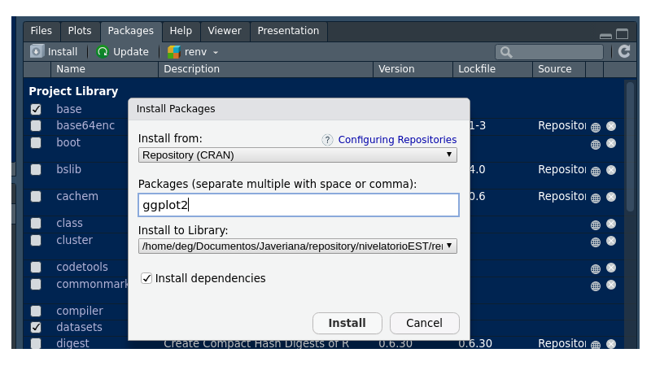
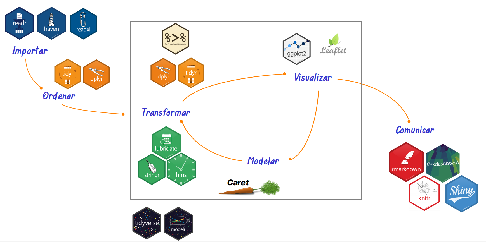

```{r setup, include=FALSE}
knitr::opts_chunk$set(echo = TRUE, message = FALSE, warning = FALSE, comment = NA, collapse = FALSE)
```

<br/>

Un **paquete** es una colección de funciones, datos y documentación que agrega capacidades a **R**. Hay paquetes para hacer gráficos, leer archivos de Excel, ajustar modelos o crear documentos.

Funcionan como las aplicaciones de un celular: una aplicación se **instala** una sola vez y se **abre** cada vez que se va a usar. En **R**, un paquete se instala con `install.packages()` y se abre en cada sesión con `library()`.

<br/>

## <span style="color:#034a94">**¿Paquete o librería?**</span>

Muchas personas usan las dos palabras como sinónimos, pero [no significan lo mismo](https://www.r-bloggers.com/2013/01/packages-v-libraries-in-r/):

- Un **paquete** (*package*) es lo que se instala y se usa, como `ggplot2`.
- Una **biblioteca** (*library*) es la carpeta del computador donde quedan guardados los paquetes.

La función se llama `library()`, pero lo que recibe es el nombre de un paquete. En este curso se usa la palabra **paquete**. Para ver dónde están las bibliotecas de su computador puede ejecutar `.libPaths()`.

<br/>

## <span style="color:#034a94">**¿Qué paquetes vienen con R?**</span>

Al instalar **R** ya quedan disponibles varios paquetes, y algunos se cargan automáticamente. Por eso `mean()` o `plot()` funcionan sin instalar nada. La función `search()` muestra lo que está activo en la sesión:

```{r, eval=FALSE}
search()
```

```{r, echo=FALSE}
x <- c(".GlobalEnv", "package:stats", "package:graphics", "package:grDevices", "package:utils", "package:datasets", "package:methods", "Autoloads", "package:base")
x
```

| Paquete    | Para qué sirve                                       | Ejemplos de funciones      |
|:-----------|:-----------------------------------------------------|:---------------------------|
| `base`     | Funciones esenciales del lenguaje                    | `sum()`, `c()`, `factor()` |
| `stats`    | Estadística: pruebas, modelos y distribuciones       | `lm()`, `t.test()`, `rnorm()` |
| `graphics` | Gráficos básicos                                     | `plot()`, `hist()`         |
| `utils`    | Herramientas generales, como leer archivos e instalar paquetes | `read.csv()`, `install.packages()` |
| `datasets` | Bases de datos de ejemplo                            | `iris`, `mtcars`           |

<br/>

## <span style="color:#034a94">**¿Dónde se publican los paquetes?**</span>

| Repositorio | Qué contiene                                         | Cómo se instala                          |
|:------------|:-----------------------------------------------------|:-----------------------------------------|
| [CRAN](https://cran.r-project.org/web/packages/) | El repositorio principal, con más de 25 000 paquetes | `install.packages("paquete")` |
| [Bioconductor](https://bioconductor.org/) | Paquetes para bioinformática                | `BiocManager::install("paquete")`        |
| GitHub      | Paquetes en desarrollo o creados por grupos y personas, como el del curso | `remotes::install_github("usuario/paquete")` |

Las [vistas de tareas de CRAN](https://cran.r-project.org/web/views/) organizan los paquetes por tema y ayudan a encontrar uno para una tarea concreta.

<br/>

## <span style="color:#034a94">**¿Cómo instalar un paquete?**</span>

Hay dos formas. La instalación se hace **una sola vez** en cada computador, salvo que se quiera actualizar el paquete.

**1. Desde la consola.** Es la forma más común. El nombre del paquete va entre comillas:

```{r, eval=FALSE}
install.packages("ggplot2")
```

**2. Desde RStudio.** En la pestaña **Packages**, se hace clic en **Install**, se escribe el nombre y se confirma.

```{r, echo=FALSE, out.width="70%", fig.align="center", fig.cap="Ventana para instalar paquetes en RStudio", fig.alt="Pestaña Packages de RStudio con la ventana Install Packages y el nombre ggplot2 escrito"}

```

Un paquete puede necesitar otros para funcionar, llamados **dependencias**. **R** los instala de forma automática, así que es normal ver mensajes sobre varios paquetes.

<div class="content-box-gray">
### <span style="color:#686868">**Recomendación**</span>

Instale los paquetes en la consola y no deje `install.packages()` en sus scripts o archivos `.Rmd`. De lo contrario, el paquete se instalaría de nuevo cada vez que se ejecute el código.
</div>

<br/>

## <span style="color:#034a94">**¿Cómo usar un paquete?**</span>

Instalar un paquete no lo activa. En cada sesión nueva de **R** hay que cargarlo con `library()`, esta vez sin necesidad de comillas:

```{r, eval=FALSE}
library(ggplot2)

ggplot(iris, aes(x = Sepal.Length, y = Petal.Length)) +
  geom_point()
```

| Acción     | Función               | ¿Cuándo?                   | ¿Lleva comillas? |
|:-----------|:----------------------|:---------------------------|:-----------------|
| Instalar   | `install.packages()`  | Una vez en cada computador | Sí               |
| Cargar     | `library()`           | En cada sesión de **R**    | No es necesario  |

Si el paquete no está instalado, `library()` genera un error:

```{r, error=TRUE}
library(paquetequenoexiste)
```

### <span style="color:#034a94">**Usar una función sin cargar el paquete**</span>

Con `paquete::función()` se usa una función sin cargar todo el paquete. También deja claro de dónde viene. Es lo que se hizo con `knitr::kable()` en la página [RMarkdown](recurso102.html).

```{r}
knitr::kable(head(iris, 2))
```

<br/>

## <span style="color:#034a94">**¿Qué pasa si dos paquetes usan el mismo nombre?**</span>

Dos paquetes pueden tener funciones con el mismo nombre. Si ambos están cargados, [se usa la del último paquete cargado](https://blog.r-project.org/2019/03/19/managing-search-path-conflicts/), y la otra queda **enmascarada** (*masked*). **R** lo advierte con un mensaje. Por ejemplo, `dplyr` tiene una función `filter()`, y `stats` también:

```{r, message=TRUE}
library(dplyr)
```

Este mensaje no es un error. Indica que, desde ahora, `filter()` será la de `dplyr`. Para usar una versión específica se escribe el nombre del paquete:

```{r}
dplyr::filter(iris, Sepal.Length > 7.6)
```

Esto importa, por ejemplo, con `select()`. Si se carga `MASS` después de `dplyr`, `select()` deja de ser la de `dplyr`, y el código puede fallar con un mensaje confuso. La solución es escribir `dplyr::select()`.

<br/>

## <span style="color:#034a94">**¿Cómo conocer un paquete?**</span>

| Quiero saber                   | Instrucción                       |
|:-------------------------------|:----------------------------------|
| Qué funciones tiene            | `help(package = "ggplot2")`       |
| Cómo se usa una función        | `?ggplot`                         |
| Si tiene guías con ejemplos    | `vignette(package = "ggplot2")`   |
| Qué versión tengo              | `packageVersion("ggplot2")`       |
| Qué paquetes tengo instalados  | `rownames(installed.packages())`  |
| Qué está cargado en la sesión  | `sessionInfo()`                   |
| Cómo citarlo en un informe     | `citation("ggplot2")`             |

<div class="content-box-gray">
### <span style="color:#686868">**Citar los paquetes**</span>

Cuando un informe usa un paquete, conviene citarlo. La función `citation()` entrega la referencia. Sin argumentos, muestra cómo citar **R**.
</div>

```{r, eval=FALSE}
citation()
citation("ggplot2")
```

<br/>

## <span style="color:#034a94">**¿Cómo actualizar los paquetes?**</span>

Los paquetes cambian con el tiempo. Se actualizan con el botón **Update** de la pestaña **Packages** o con esta instrucción, que revisa cuáles tienen una [versión más reciente](https://stat.ethz.ch/R-manual/R-devel/library/utils/html/update.packages.html):

```{r, eval=FALSE}
update.packages()
```

No conviene actualizar en medio de una entrega, porque un cambio podría alterar el funcionamiento del código.

<br/>

## <span style="color:#034a94">**¿Cómo instalar un paquete desde GitHub?**</span>

**¿Qué problema resuelve?** `install.packages()` solo busca en CRAN. Un paquete publicado únicamente en GitHub, como el del curso, necesita otra herramienta.

**¿Qué hace?** El paquete [`remotes`](https://cran.r-project.org/web/packages/remotes/refman/remotes.html) permite instalar paquetes desde GitHub. Su función `install_github()` recibe el texto `"usuario/repositorio"` y también revisa las dependencias.

**¿Cómo se usa?**

```{r, eval=FALSE}
install.packages("remotes")                # solo la primera vez
remotes::install_github("usuario/paquete")
```

Si durante la instalación pregunta si desea actualizar otros paquetes, puede elegir la opción **None** para omitirlo.

<br/>

## <span style="color:#034a94">**¿Qué es paqueteMETODOS?**</span>

**¿Qué es?** `paqueteMETODOS` fue creado para este curso. Reúne bases de datos, funciones y tutoriales, de modo que todos trabajen con la misma información. No está en CRAN.

**¿Cómo se instala?** Se ejecuta una sola vez:

```{r, eval=FALSE}
install.packages("remotes")
remotes::install_github("Centromagis/paqueteMETODOS")
```

**¿Cómo se usa?** Se carga y luego se llama la base de datos:

```{r, eval=FALSE}
library(paqueteMETODOS)
data("CarreraLuz22")
head(CarreraLuz22)
```

### <span style="color:#034a94">**Bases de datos**</span>

| Base                 | Tamaño             | Contenido                                       |
|:---------------------|:-------------------|:------------------------------------------------|
| `CarreraLuz22`       | 1,922 × 7          | Atletas de la carrera La Luz 2022 en Cali       |
| `CarreraLuz22F`      | 744 × 7            | Mujeres de la carrera                           |
| `CarreraLuz22M`      | 1,178 × 7          | Hombres de la carrera                           |
| `vivienda`           | 8,322 × 13         | Viviendas de Cali                               |
| `vivienda_faltantes` | 8,330 × 13         | Viviendas de Cali con datos faltantes           |
| `vivienda4`          | 1,706 × 5          | Viviendas de Cali, con menos variables          |
| `rotacion`           | 1,470 × 24         | Empleados de una compañía                       |
| `rotacionNA`         | 1,470 × 25         | Empleados de una compañía con datos faltantes   |
| `inflacion2022`      | 360 × 6            | Inflación en Colombia hasta 2022                |
| `seriesCOL`          | 74 × 3             | Inflación y tasa de cambio de Colombia          |
| `ventas`             | 15 × 3             | Ventas de empleados                             |
| `arboles`            | 90 × 4             | Características de árboles                      |
| `biomasa`            | 90 × 8             | Biomasa de árboles                              |

El paquete también incluye las bases `CarreraLuz22_c1F` a `CarreraLuz22_c5F` para mujeres y `CarreraLuz22_c1M` a `CarreraLuz22_c5M` para hombres. Son acumuladas: por ejemplo, `CarreraLuz22_c3F` contiene a las mujeres de las categorías 3, 4 y 5. Para trabajar con una sola categoría se filtra `CarreraLuz22`.

### <span style="color:#034a94">**Funciones**</span>

Estas son algunas de sus funciones. Los argumentos son estos: `z` es el percentil de la normal, como 1.96 para 95 % de confianza; `s2` es la varianza; `p` es la proporción y `e` es el error máximo.

| Función                     | Para qué sirve                                            |
|:----------------------------|:----------------------------------------------------------|
| `Cnk(n, k)`                 | Combinaciones de n elementos tomados de a k               |
| `Pnk(n, k)`                 | Permutaciones de n elementos tomados de a k               |
| `sizemu(z, s2, e)`          | Tamaño de muestra para estimar una media                  |
| `sizep(z, p, e)`            | Tamaño de muestra para estimar una proporción             |
| `adjusted_size(n, N)`       | Ajusta el tamaño de muestra `n` a una población de tamaño `N` |

Ejemplos con sus resultados:

```{r, eval=FALSE}
Cnk(10, 2)                # 45
Pnk(10, 2)                # 90
sizemu(1.96, 245, 2)      # 235.298
sizep(1.96, 0.5, 0.02)    # 2401
adjusted_size(385, 500)   # 217.7602
```

<br/>

## <span style="color:#034a94">**¿Qué paquetes se usan en ciencia de datos?**</span>

Cada etapa de un análisis cuenta con paquetes especializados.

```{r, echo=FALSE, out.width="100%", fig.align="center", fig.cap="Etapas del análisis de datos y paquetes empleados", fig.alt="Diagrama de las etapas importar, ordenar, transformar, visualizar, modelar y comunicar con los logos de sus paquetes"}

```

### <span style="color:#034a94">**El tidyverse**</span>

El [tidyverse](https://tidyverse.tidyverse.org/) es una colección de paquetes diseñados para trabajar juntos. Con una sola instrucción se instala todo el grupo:

```{r, eval=FALSE}
install.packages("tidyverse")    # solo la primera vez
library(tidyverse)               # activa los paquetes principales
```

`library(tidyverse)` activa estos paquetes:

| Paquete     | Para qué sirve                                   |
|:------------|:-------------------------------------------------|
| `ggplot2`   | Crear gráficos                                   |
| `dplyr`     | Filtrar, seleccionar, ordenar y resumir datos    |
| `tidyr`     | Ordenar la estructura de las tablas              |
| `readr`     | Leer archivos de texto como `.csv`               |
| `tibble`    | Trabajar con una versión moderna del data frame  |
| `purrr`     | Aplicar funciones a muchos elementos             |
| `stringr`   | Trabajar con textos                              |
| `forcats`   | Trabajar con factores                            |
| `lubridate` | Trabajar con fechas y horas                      |

Otros paquetes, como `readxl` para archivos de Excel y `haven` para SPSS, Stata y SAS, se instalan con el tidyverse, pero cada uno se carga con su propio `library()`.

### <span style="color:#034a94">**Paquetes que se usan en esta unidad**</span>

| Paquete          | Para qué sirve                                          | Tema                      |
|:-----------------|:--------------------------------------------------------|:--------------------------|
| `rmarkdown`, `knitr` | Generar documentos y tablas                         | Informes                  |
| `tidyverse`      | Importar, transformar y graficar datos                  | Procesamiento y gráficas  |
| `readxl`         | Leer archivos de Excel                                  | Importar                  |
| `summarytools`   | Obtener tablas de frecuencia y resúmenes descriptivos   | Análisis de datos         |
| `e1071`          | Calcular asimetría y curtosis, entre otras funciones    | Indicadores de forma      |
| `kableExtra`     | Dar mejor formato a las tablas                          | Tablas                    |
| `plotly`         | Convertir gráficos en interactivos                      | Gráficas                  |
| `gganimate`      | Crear gráficos animados                                 | Gráficas                  |
| `naniar`, `VIM`  | Explorar y visualizar datos faltantes                   | Ordenar                   |
| `zoo`            | Trabajar con series de tiempo y completar datos faltantes | Ordenar                 |

Para instalarlos de una sola vez:

```{r, eval=FALSE}
install.packages(c("rmarkdown", "tidyverse", "readxl", "summarytools", "e1071",
                   "kableExtra", "plotly", "gganimate", "naniar", "VIM", "zoo"))
```

<br/>

## <span style="color:#034a94">**¿Cómo elegir un paquete?**</span>

Varios paquetes pueden hacer lo mismo. Antes de elegir uno conviene revisar lo siguiente:

- Si está en CRAN, que revisa los paquetes antes de publicarlos.
- Si tiene documentación clara y ejemplos.
- Si se ha actualizado en los últimos años.
- Si otras personas lo usan y lo recomiendan.
- Si sus resultados se pueden comparar con otra fuente.

Que un paquete esté publicado no garantiza que el método sea el adecuado para sus datos. Esa decisión sigue siendo del analista.

<br/>

## <span style="color:#034a94">**Errores frecuentes**</span>

| Problema                                  | Causa                                    | Solución                                       |
|:------------------------------------------|:-----------------------------------------|:-----------------------------------------------|
| `there is no package called 'ggplot2'`    | El paquete no está instalado             | Ejecutar `install.packages("ggplot2")`         |
| `could not find function "ggplot"`        | El paquete no está cargado               | Ejecutar `library(ggplot2)`                    |
| `object 'ggplot2' not found` al instalar  | Faltan las comillas                      | Escribir `install.packages("ggplot2")`         |
| `package 'x' is not available`            | El nombre está mal escrito o no está en CRAN | Revisar mayúsculas y el nombre             |
| `namespace ... is already loaded`         | Se quiere actualizar un paquete en uso   | Reiniciar **R** e intentar de nuevo            |
| La función da un error extraño            | Otra función la enmascaró                | Usar `paquete::función()`                      |

<br/>

## <span style="color:#034a94">**Retos**</span>

<div class="content-box-yellow">
### <span style="color:#686868">**Reto 1. ¿Qué falta?**</span>

Un estudiante abre **RStudio** y ejecuta el siguiente código. Obtiene el error `could not find function "ggplot"`, aunque ayer el código funcionó. ¿Qué pasó y cómo se corrige?

```{r, eval=FALSE}
ggplot(iris, aes(Sepal.Length, Petal.Length)) + geom_point()
```

<details>
<summary>Ver solución</summary>

El paquete sigue instalado, pero la sesión es nueva y no se ha cargado. Se debe agregar `library(ggplot2)` al inicio del script. No hace falta instalarlo de nuevo.

</details>
</div>

<div class="content-box-yellow">
### <span style="color:#686868">**Reto 2. Corrija las instrucciones**</span>

Encuentre el error en cada línea.

```{r, eval=FALSE}
install.packages(ggplot2)
install.packages(install.packages("dplyr"))
library(update.packages())
library(GGPLOT2)
```

<details>
<summary>Ver solución</summary>

```{r, eval=FALSE}
install.packages("ggplot2")    # faltaban las comillas
install.packages("dplyr")      # estaba repetida la función
update.packages()             # no va dentro de library()
library(ggplot2)               # R distingue mayúsculas de minúsculas
```

</details>
</div>

<div class="content-box-yellow">
### <span style="color:#686868">**Reto 3. El filtro que no filtra**</span>

Sin cargar ningún paquete adicional, una persona ejecuta `filter(iris, Species == "setosa")` y obtiene un error. ¿Qué función se está usando realmente? ¿Cómo se soluciona?

<details>
<summary>Ver solución</summary>

Se está usando `stats::filter()`, que sirve para series de tiempo. Hay que usar la de `dplyr`, con `library(dplyr)` o escribiendo el nombre del paquete:

```{r}
head(dplyr::filter(iris, Species == "setosa"), 2)
```

</details>
</div>

<div class="content-box-yellow">
### <span style="color:#686868">**Reto 4. Conozca el paquete del curso**</span>

Instale `paqueteMETODOS`. Calcule cuántas personas de la categoría `4. Veteranos B` hay en `CarreraLuz22` y su tiempo promedio en minutos. Después use `sizep()` para hallar el tamaño de muestra que estima una proporción con 95 % de confianza, `p = 0.5` y error de 0.05.

<details>
<summary>Ver solución</summary>

```{r, eval=FALSE}
library(paqueteMETODOS)
library(dplyr)

data("CarreraLuz22")

CarreraLuz22 |>
  filter(categoria == "4. Veteranos B") |>
  summarise(personas = n(), promedio = mean(timerun / 60))

sizep(1.96, 0.5, 0.05)
```

Son 227 personas, con un promedio de 64.5 minutos, y `sizep()` da 384.16, por lo que se necesitan 385. El tamaño de muestra se redondea hacia arriba.

</details>
</div>

<br/>

## <span style="color:#034a94">**Libros y recursos**</span>

- Wickham, H., Çetinkaya-Rundel, M. y Grolemund, G. (2023). [R para Ciencia de Datos](https://davidrsch.github.io/r4ds-es/) (2.ª ed., traducción al español). Enseña a usar los paquetes del tidyverse.
- [Vistas de tareas de CRAN](https://cran.r-project.org/web/views/): paquetes organizados por tema.
- [Hojas de referencia de Posit](https://rstudio.github.io/cheatsheets/): resúmenes de los paquetes más usados.

<br/>

## <span style="color:#034a94">**Referencias**</span>

- R Core Team. Documentación de `library()`, `install.packages()` y [`update.packages()`](https://stat.ethz.ch/R-manual/R-devel/library/utils/html/update.packages.html).
- Rainey, C. [Packages v. Libraries in R](https://www.r-bloggers.com/2013/01/packages-v-libraries-in-r/).
- [remotes: R Package Installation from Remote Repositories](https://cran.r-project.org/web/packages/remotes/refman/remotes.html).
- Tierney, L. (2019). [Managing Search Path Conflicts](https://blog.r-project.org/2019/03/19/managing-search-path-conflicts/). The R Blog.
- Wickham, H. et al. [tidyverse](https://tidyverse.tidyverse.org/).

<br/>

*Última revisión: 4 de noviembre de 2026.*

<br/><br/>
