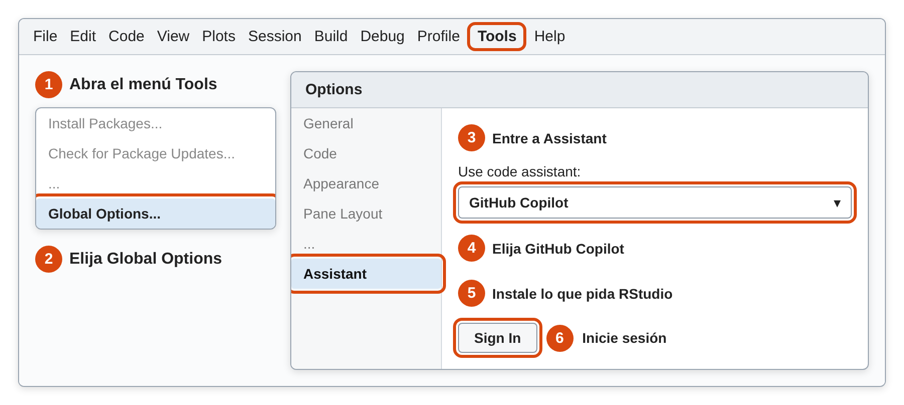
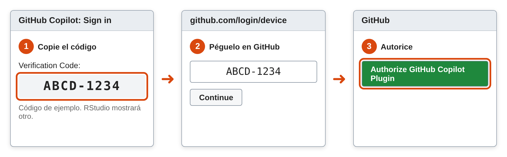
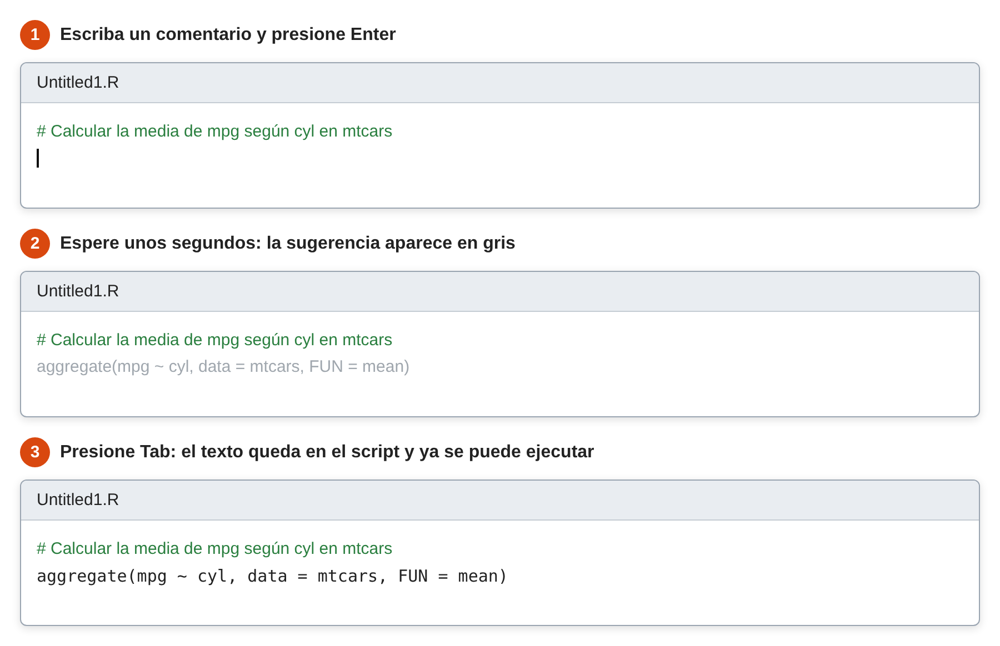

```{r setup, include=FALSE}
knitr::opts_chunk$set(echo = TRUE, message = FALSE, warning = FALSE, comment = NA, collapse = TRUE)
```

<br/>

Las herramientas de inteligencia artificial (IA) pueden sugerir código, explicar un error o proponer un gráfico sin salir de **RStudio**. Son útiles, pero no reemplazan el criterio estadístico: un código puede ejecutarse sin errores y aun así responder mal la pregunta.

En esta página se presentan las principales opciones y la forma de usarlas con responsabilidad. La regla es simple: **use solo el código que pueda explicar y verificar**.

<br/>

## <span style="color:#034a94">**¿Qué opciones existen?**</span>

| Herramienta      | Qué hace                                                 | Costo                                        | Se recomienda para                  |
|:-----------------|:---------------------------------------------------------|:---------------------------------------------|:------------------------------------|
| GitHub Copilot   | Sugiere código mientras se escribe                       | Tiene plan gratuito con límites y plan para estudiantes | Empezar                 |
| Posit Assistant  | Conversa, lee la sesión de **R** y trabaja con los datos cargados | Suscripción mensual                 | Quien quiera un asistente completo  |

<div class="content-box-gray">
### <span style="color:#686868">**Información que cambia rápido**</span>

Los planes, precios y modelos cambian con frecuencia. Lo indicado aquí corresponde a la fecha de revisión de esta página. Antes de pagar o instalar, confírmelo en la fuente oficial.
</div>

<br/>

## <span style="color:#034a94">**¿Cómo activar GitHub Copilot?**</span>

**¿Qué problema resuelve?** Ayuda a escribir código más rápido, sobre todo en tareas repetitivas o cuando no se recuerda la instrucción exacta.

**¿Qué hace?** Mientras se escribe en **RStudio**, propone la continuación del código en letra gris. Si la propuesta sirve, se acepta con la tecla **Tab**. [Se usa principalmente para generar código](https://docs.posit.co/ide/user/ide/guide/tools/copilot.html), no para conversar.

**¿Qué son GitHub y Copilot?** **GitHub** es un sitio web para guardar y compartir código. **Copilot** es su asistente de IA. Para usarlo en **RStudio** hacen falta tres cosas, en este orden: una cuenta de GitHub, Copilot activado en esa cuenta y **RStudio** conectado a la cuenta.

**Antes de empezar**, revise en **Help > About RStudio** que su versión sea 2023.09.0 o posterior. Las versiones de RStudio Desktop se identifican por año, así que cualquier versión de 2024 en adelante sirve. También necesita internet.

### <span style="color:#034a94">**Paso 1. Cree una cuenta en GitHub**</span>

Ingrese a <https://github.com/signup>, escriba su correo, una contraseña y un nombre de usuario, y confirme el correo. Si ya tiene cuenta, siga al paso 2.

### <span style="color:#034a94">**Paso 2. Active Copilot en su cuenta**</span>

Elija **una** de estas opciones. Ninguna requiere comprar un plan.

| Opción | Para quién | Cómo se activa |
|:-------|:-----------|:---------------|
| **Copilot Free** | Cualquier cuenta personal. Incluye hasta [2,000 sugerencias al mes](https://docs.github.com/en/copilot/concepts/billing/individual-plans) | Inicie sesión en GitHub, haga clic en su foto de perfil, arriba a la derecha, y luego en **Copilot settings**. Haga clic en [**Start using Copilot Free**](https://docs.github.com/en/copilot/how-tos/manage-your-account/get-started-with-a-copilot-plan) |
| **Copilot Student** | Estudiantes verificados. Incluye sugerencias ilimitadas | Ingrese a <https://github.com/settings/education/benefits> y haga clic en **Start an application**. Cuando lo aprueben, en **Free GitHub developer resources for students and teachers** haga clic en **Learn more** y [siga las indicaciones](https://docs.github.com/en/copilot/how-tos/copilot-on-github/set-up-copilot/enable-copilot/set-up-for-students) |

<div class="content-box-gray">
### <span style="color:#686868">**Si es estudiante**</span>

La aprobación y la activación son pasos separados, y el beneficio [puede tardar varios días](https://docs.github.com/en/copilot/how-tos/copilot-on-github/set-up-copilot/enable-copilot/set-up-for-students). Si solo aparecen opciones de pago, no compre nada: espere unos días e intente de nuevo. Mientras tanto, puede empezar con Copilot Free.
</div>

### <span style="color:#034a94">**Paso 3. Elija Copilot en RStudio**</span>

En **RStudio**, ingrese a **Tools > Global Options > Assistant**. En **Use code assistant**, elija **GitHub Copilot**. Si **RStudio** pide descargar componentes, acepte y espere a que termine. Luego haga clic en **Sign In**.

```{r, echo=FALSE, out.width="100%", fig.align="center", fig.cap="Ruta para activar Copilot en RStudio. Esquema ilustrativo: la ventana real puede verse distinta", fig.alt="Esquema del menú Tools, la opción Global Options, la sección Assistant, la lista Use code assistant con GitHub Copilot y el botón Sign In"}

```

### <span style="color:#034a94">**Paso 4. Conecte RStudio con su cuenta**</span>

**RStudio** abre una ventana con un código de verificación. Cópielo, ingrese a <https://github.com/login/device>, péguelo y haga clic en **Continue**. Después haga clic en **Authorize GitHub Copilot Plugin**. Al volver a **RStudio** debe aparecer su usuario. Cierre la ventana **Options** con **OK**.

```{r, echo=FALSE, out.width="100%", fig.align="center", fig.cap="Conexión de RStudio con GitHub. Esquema ilustrativo", fig.alt="Tres ventanas en secuencia: copiar el código de verificación en RStudio, pegarlo en GitHub y autorizar el complemento"}

```

### <span style="color:#034a94">**Paso 5. Pruébelo**</span>

Abra un script con **File > New File > R Script**. Escriba el siguiente comentario, presione **Enter** y espere unos segundos, sin escribir nada más:

```{r, eval=FALSE}
# Calcular la media de mpg según cyl en mtcars
```

Si aparece una sugerencia en gris, presione **Tab** para aceptarla. Copilot funciona si aparece el código, aunque no sea idéntico al del ejemplo, porque sus sugerencias pueden variar.

```{r, echo=FALSE, out.width="90%", fig.align="center", fig.cap="Cómo se ve una sugerencia de Copilot. Esquema ilustrativo", fig.alt="Tres momentos en un script: el comentario escrito, la sugerencia en gris y el código aceptado"}

```

Al ejecutar la línea del ejemplo se obtiene:

```{r}
aggregate(mpg ~ cyl, data = mtcars, FUN = mean)
```

### <span style="color:#034a94">**¿Cómo se responde a una sugerencia?**</span>

| Quiero                         | Acción                                                                 |
|:-------------------------------|:-----------------------------------------------------------------------|
| Aceptar la sugerencia          | Presionar **Tab**                                                      |
| Rechazarla                     | [Presionar **Enter** o seguir escribiendo](https://docs.posit.co/ide/user/ide/guide/tools/copilot.html) |
| Ejecutar el código aceptado    | Ejecutarlo como cualquier código, con **Ctrl + Enter** (**Cmd + Return** en macOS) |
| Hacer una pregunta simple      | Escribir un comentario que empiece con `# q:` y termine con `?`. La respuesta aparece como `# a:` |

Por ejemplo:

```{r, eval=FALSE}
# q: ¿Qué diferencia hay entre sd() y var()?
```

### <span style="color:#034a94">**¿Y si no aparece nada?**</span>

- Confirme que el archivo abierto sea un script, por ejemplo `.R`, y no la consola.
- En **Tools > Global Options > Code > Completion**, revise que **Show code completions** esté en **Automatically**.
- En **Tools > Global Options > Assistant**, confirme que aparezca su usuario. Si no aparece, haga clic en **Sign In**.
- En esa misma ventana, use el botón **Diagnostics**, que genera un informe de la conexión.
- Revise que no haya agotado las sugerencias del plan Free.

La [guía de Posit](https://docs.posit.co/ide/user/ide/guide/tools/copilot.html) tiene capturas de pantalla de este proceso.

<br/>

## <span style="color:#034a94">**¿Qué es Posit Assistant?**</span>

**¿Qué problema resuelve?** Un chat externo no conoce los datos de la sesión. Por eso hay que describirle la base de datos y copiar cada error.

**¿Qué hace?** [Posit Assistant](https://docs.posit.co/posit-ai/whats-new/) es un asistente que funciona dentro de **RStudio**. Lee la sesión, incluidos los paquetes y data frames cargados, y puede escribir código, corregir errores, explorar los datos y generar informes en Quarto.

**¿Qué se necesita?** Una versión compatible de **RStudio** y una [suscripción](https://posit.co/ai). En esta revisión cuesta 20 dólares al mes, incluye 15 dólares en créditos y no tiene descuento académico. **RStudio** [sigue siendo gratuito](https://posit.co/blog/posit-ai-now-available-all) para quien no use estas funciones.

<br/>

## <span style="color:#034a94">**¿Cómo hacer una buena petición?**</span>

Una petición clara reduce los errores. Conviene indicar los datos, las variables, el objetivo y la forma de la respuesta.

| Petición vaga          | Petición clara                                                                                  |
|:-----------------------|:------------------------------------------------------------------------------------------------|
| Haz un gráfico         | Con `mtcars`, crea en `ggplot2` un diagrama de dispersión de `wt` y `mpg`, con ejes en español  |
| Arregla esto           | Este código produce el error `object 'x' not found`. Explica la causa y corrígelo               |
| Analiza mis datos      | Calcula la media, la mediana y la desviación estándar de `timerun` por `sex` en `CarreraLuz22`  |
| ¿Qué prueba uso?       | Tengo dos mediciones de las mismas 10 personas. ¿Qué prueba compara las medias y qué supuestos tiene? |

También se le puede pedir que explique cada línea, o que proponga una forma de comprobar el resultado.

<br/>

## <span style="color:#034a94">**¿Cómo verificar una respuesta?**</span>

La IA puede inventar funciones, usar argumentos que no existen o elegir un método inadecuado. Antes de usar una respuesta conviene revisar lo siguiente:

- **¿Se ejecuta?** Pruébela en una sesión nueva.
- **¿La entiendo?** Debe poder explicar cada línea.
- **¿Existe?** Revise las funciones con `?función`.
- **¿Responde mi pregunta?** Revise que use las variables y filas correctas.
- **¿El método es adecuado?** Revise el tipo de variable, el diseño del estudio y los supuestos.
- **¿El resultado tiene sentido?** Compárelo con un cálculo sencillo, una tabla o un gráfico.
- **¿Las referencias existen?** Busque cada libro o artículo citado.

<br/>

## <span style="color:#034a94">**¿Qué información no se debe compartir?**</span>

Estas herramientas pueden enviar a servidores externos [fragmentos de código o archivos completos](https://docs.posit.co/ide/user/ide/guide/tools/copilot.html). Posit Assistant, además, lee los data frames de la sesión. Posit [recomienda no introducir](https://posit.co/ai) información altamente sensible.

| No comparta                                         | Alternativa                                                  |
|:----------------------------------------------------|:-------------------------------------------------------------|
| Datos personales, como nombres o documentos         | Elimínelos o reemplácelos por un código                      |
| Datos de salud o financieros                        | Use datos simulados con la misma estructura |
| Datos confidenciales de una empresa o institución   | Pregunte antes qué herramientas están autorizadas            |
| Claves y contraseñas                                | Guárdelas fuera del código                                   |

<br/>

## <span style="color:#034a94">**¿Cómo usar la IA en el curso?**</span>

La responsabilidad del trabajo sigue siendo de quien lo entrega. La guía de la [UNESCO](https://gcedclearinghouse.org/en/node/129341) propone un enfoque centrado en la agencia humana. En la práctica:

- Siga las reglas de cada asignatura sobre el uso de IA.
- Intente primero resolver el problema por su cuenta, porque así se aprende a detectar errores.
- Si la usó, indique qué herramienta usó y para qué.
- Revise que cada cifra del informe salga de su propio código.

<br/>

## <span style="color:#034a94">**Errores frecuentes**</span>

| Problema                                       | Causa                                                  | Solución                                         |
|:-----------------------------------------------|:-------------------------------------------------------|:-------------------------------------------------|
| No aparece la opción **Assistant**             | La versión de **RStudio** es antigua                   | Actualizar **RStudio**                           |
| Copilot no muestra sugerencias                 | No hay sesión activa, o no hay internet o cupo disponible | Revisar **Tools > Global Options > Assistant** |
| `could not find function`                      | Falta cargar el paquete o la función no existe         | Revisar `library()` y la documentación           |
| `unused argument`                              | La IA usó un argumento que la función no tiene         | Revisar la función con `?función`                |
| El código funciona, pero el resultado es absurdo | La petición no era clara o el método es inadecuado   | Revisar la petición, las variables y el método   |

<br/>

## <span style="color:#034a94">**Retos**</span>

<div class="content-box-yellow">
### <span style="color:#686868">**Reto 1. Mejore la petición**</span>

Reescriba esta petición para que sea clara: *Haz una tabla de los carros*. Quiere obtener, con la base `mtcars`, la media de `mpg` por número de cilindros.

<details>
<summary>Ver solución</summary>

Una versión posible es: *Con la base `mtcars` de R, crea una tabla con la media de `mpg` según `cyl`. Usa `aggregate()`, redondea a dos decimales y muéstrala con `knitr::kable()`.*

```{r}
tabla <- aggregate(mpg ~ cyl, data = mtcars, FUN = mean)
knitr::kable(tabla, digits = 2)
```

</details>
</div>

<div class="content-box-yellow">
### <span style="color:#686868">**Reto 2. El dato faltante**</span>

Suponga que, para obtener la media de `ventas`, una herramienta propone el siguiente código. Se ejecuta sin errores. ¿Es correcto?

```{r}
ventas <- c(120, 85, NA, 240, 60)
ventas[is.na(ventas)] <- 0
mean(ventas)
```

<details>
<summary>Ver solución</summary>

No es correcto. Un dato faltante no significa que la venta fue cero, y ese reemplazo baja la media. Lo adecuado es excluirlo, salvo que se sepa que el valor era cero:

```{r}
ventas <- c(120, 85, NA, 240, 60)
mean(ventas, na.rm = TRUE)
```

La media pasa de 101 a 126.25. Además, conviene informar que hay un dato faltante.

</details>
</div>

<div class="content-box-yellow">
### <span style="color:#686868">**Reto 3. El método equivocado**</span>

La base `sleep` contiene el aumento en horas de sueño de 10 pacientes con dos medicamentos. La variable `ID` identifica al paciente. Una herramienta propone el siguiente código y concluye que no hay diferencia, porque el valor p es mayor que 0.05. Revise `sleep` y `?sleep`. ¿Qué está mal?

```{r}
t.test(extra ~ group, data = sleep)$p.value
```

<details>
<summary>Ver solución</summary>

El código trata los datos como dos grupos independientes, pero son 10 pacientes medidos dos veces. Es un diseño pareado:

```{r}
extra1 <- sleep$extra[sleep$group == 1]
extra2 <- sleep$extra[sleep$group == 2]

t.test(extra2, extra1, paired = TRUE)$p.value
```

Con la prueba pareada, el valor p es cercano a 0.003 y la diferencia media es de 1.58 horas. La conclusión cambia. Los dos códigos se ejecutan sin errores: lo que los distingue es el diseño del estudio.

</details>
</div>

<div class="content-box-yellow">
### <span style="color:#686868">**Reto 4. ¿Qué se puede compartir?**</span>

Debe analizar una base de pacientes con las columnas `nombre`, `cedula`, `edad`, `diagnostico` y `costo`, y quiere pedir ayuda a una herramienta externa para hacer un gráfico. ¿Cómo lo haría sin exponer esa información?

<details>
<summary>Ver solución</summary>

No se debe enviar la base. Se puede describir solo su estructura o crear una base simulada con las mismas columnas. Las funciones se prueban en los datos simulados y después se ejecutan localmente con los datos reales.

```{r}
set.seed(1)
simulada <- data.frame(
  edad = sample(18:80, 5),
  diagnostico = sample(c("A", "B"), 5, replace = TRUE),
  costo = round(runif(5, 100, 500))
)
str(simulada)
```

También hay que confirmar si las reglas de la institución permiten usar la herramienta.

</details>
</div>

<br/>

## <span style="color:#034a94">**Libros y recursos**</span>

- [Posit AI](https://posit.co/ai): productos, precios y preguntas frecuentes.
- [GitHub Copilot en RStudio](https://docs.posit.co/ide/user/ide/guide/tools/copilot.html): guía oficial de Posit.

<br/>

## <span style="color:#034a94">**Referencias**</span>

- GitHub. [Plans for GitHub Copilot](https://docs.github.com/en/copilot/concepts/billing/individual-plans), [Get started with a Copilot plan](https://docs.github.com/en/copilot/how-tos/manage-your-account/get-started-with-a-copilot-plan) y [Access GitHub Copilot for free as a student](https://docs.github.com/en/copilot/how-tos/copilot-on-github/set-up-copilot/enable-copilot/set-up-for-students).
- Miao, F. y Holmes, W. (2023). [Guidance for Generative AI in Education and Research](https://gcedclearinghouse.org/en/node/129341). UNESCO.
- Mock, T., Rohrbaugh, N. y Chisholm, A. (2026). [Posit AI now available to all](https://posit.co/blog/posit-ai-now-available-all). Posit.
- Posit. [GitHub Copilot](https://docs.posit.co/ide/user/ide/guide/tools/copilot.html), [What's new with Posit AI](https://docs.posit.co/posit-ai/whats-new/) y [Posit AI](https://posit.co/ai).
- Student (1908). The probable error of the mean. *Biometrika*, 6, 1-25. Fuente de la base `sleep`.

<br/>

*Última revisión: 4 de noviembre de 2026.*

<br/><br/>
