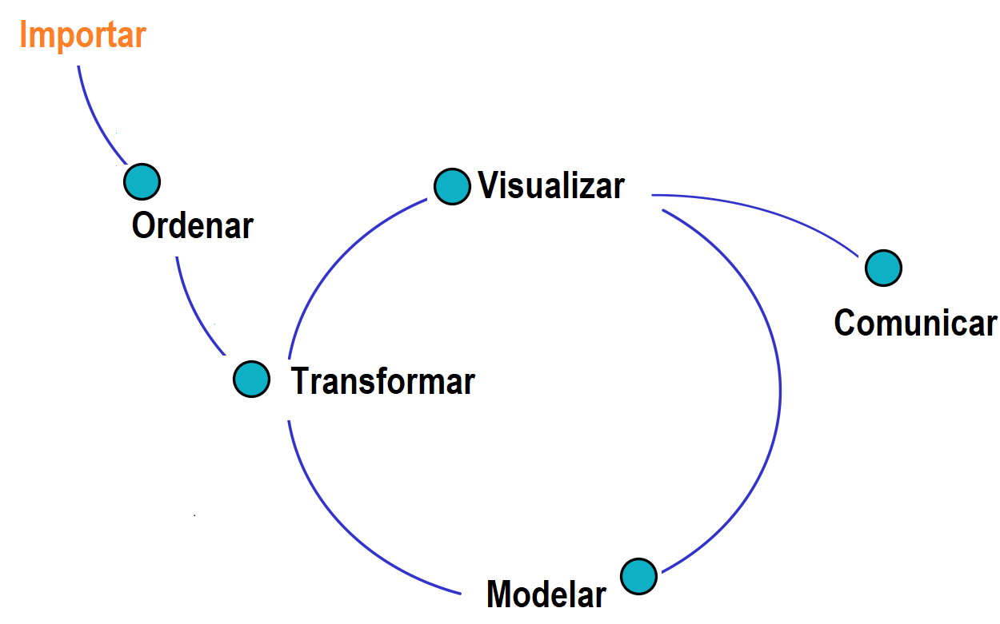

```{r setup, include=FALSE}
knitr::opts_chunk$set(echo = TRUE, message = FALSE, warning = FALSE, comment = NA, collapse = FALSE)
load("data/CarreraLuz22.rda")
load("data/vivienda_faltantes.rda")
```

<br/>

La **importación de datos** depende del formato y de la fuente que genera los datos. Es el primer paso del análisis: si los datos entran mal a **R**, todo lo que sigue queda mal. Esta página presenta el ciclo del análisis de datos y cómo importar los formatos más usados, desde archivos, paquetes e internet.

Los ejemplos usan archivos de la carpeta `data/ejemplos` de este proyecto, con una muestra de 200 viviendas de `vivienda_faltantes`: [CSV](data/ejemplos/viviendas.csv), [CSV de Excel](data/ejemplos/viviendas_excel.csv), [Excel](data/ejemplos/viviendas.xlsx), [RDS](data/ejemplos/viviendas.rds), [SPSS](data/ejemplos/viviendas.sav) y [JSON](data/ejemplos/viviendas.json). Los bloques de código se ejecutan en orden.

<br/>

## <span style="color:#034a94">**¿Cuál es el ciclo del análisis de datos?**</span>

En el **ciclo del análisis de datos** se llevan a cabo estas actividades:

- Importar los datos.
- Ordenar y estructurar los datos: identificar errores y datos faltantes, y tratarlos.
- Transformar los datos según las necesidades del análisis.
- Visualizar e interpretar la información con las herramientas de estadística descriptiva.
- Aplicar técnicas de modelamiento estadístico y visualizar sus resultados.
- Comunicar los resultados obtenidos.

La siguiente figura presenta el flujo de estas actividades. Transformar, visualizar y modelar forman un ciclo, porque lo que se aprende en una etapa puede llevar a repetir las otras.

```{r fig-ciclo, echo=FALSE, fig.cap="Ciclo del análisis de los datos", fig.alt="Diagrama que va de importar a ordenar y a transformar; luego un círculo une transformar, visualizar y modelar, y de visualizar sale una línea hacia comunicar", out.width="75%", fig.align="center"}

```

<br/>

## <span style="color:#034a94">**¿Dónde se guardan los datos?**</span>

Conviene trabajar dentro de un **proyecto de RStudio** y guardar los archivos en una carpeta llamada `data`. Así, el código usa una **ruta relativa**, que funciona en cualquier computador:

| Ruta     | Ejemplo                       | ¿Sirve en otro equipo? |
|:---------|:------------------------------|:-----------------------|
| Relativa | `data/viviendas.csv`          | Sí                     |
| Absoluta | `C:/Users/Ana/viviendas.csv`  | No                     |

La función `file.choose()` abre una ventana para buscar un archivo, pero devuelve una ruta absoluta. Sirve para explorar, no para un análisis que otras personas vayan a repetir.

<br/>

## <span style="color:#034a94">**¿Cómo importar con el menú de RStudio?**</span>

RStudio tiene un asistente en *File > Import Dataset*. Muestra una vista previa y genera el código, que conviene copiar al script para poder repetir la importación.

| Formato              | Ruta en *File > Import Dataset*        | Descripción                   |
|:---------------------|:---------------------------------------|:------------------------------|
| `.txt`, `.csv`       | *From Text* | Texto separado por un carácter |
| `.xlsx`              | *From Excel* | Archivo de Excel              |
| `.sav`               | *From SPSS* | Archivo de SPSS               |
| `.sas7bdat`          | *From SAS* | Archivo de SAS                |
| `.dta`               | *From Stata* | Archivo de Stata              |

<br/>

## <span style="color:#034a94">**¿Cómo importar con código?**</span>

| Formato     | Paquete    | Función                                  |
|:------------|:-----------|:-----------------------------------------|
| `.csv`      | `readr`    | `read_csv()` o `read_csv2()`             |
| `.csv`      | Base de R  | `read.csv()` o `read.csv2()`             |
| `.txt`      | `readr`    | `read_delim()`                           |
| `.xlsx`     | `readxl`   | `read_excel()`                           |
| `.rds`      | Base de R  | `readRDS()`                              |
| `.json`     | `jsonlite` | `fromJSON()`                             |
| `.sav`      | `haven`    | `read_sav()`                             |
| `.dta`      | `haven`    | `read_dta()`                             |
| `.sas7bdat` | `haven`    | `read_sas()`                             |

Estos paquetes se instalan una sola vez:

```{r, eval=FALSE}
install.packages(c("readr", "readxl", "haven", "jsonlite"))
```

### <span style="color:#034a94">**¿Cómo se importa un CSV?**</span>

Un archivo CSV es un texto con los valores separados por un carácter. Hay dos variantes:

| Variante                 | Separa columnas con | Decimal | Función        |
|:-------------------------|:--------------------|:--------|:---------------|
| Inglesa                  | Coma                | Punto   | `read_csv()`   |
| Excel en español         | Punto y coma        | Coma    | `read_csv2()`  |

Excel configurado en español suele guardar la segunda variante, y por eso es común en Colombia. Si se usa la función equivocada, todo queda en una sola columna.

```{r}
library(readr)

viviendas <- read_csv("data/ejemplos/viviendas.csv", show_col_types = FALSE)
dim(viviendas)

viviendas2 <- read_csv2("data/ejemplos/viviendas_excel.csv", show_col_types = FALSE)
dim(viviendas2)
```

Si los faltantes están escritos con un código, como `-99` o `NA`, el argumento `na` los convierte: `read_csv(archivo, na = c("", "NA", "-99"))`.

### <span style="color:#034a94">**¿Cómo se importa un Excel?**</span>

`read_excel()` recibe el archivo y la hoja, por nombre o número. La función `excel_sheets()` muestra las hojas que tiene.

```{r}
library(readxl)

excel_sheets("data/ejemplos/viviendas.xlsx")

viviendas3 <- read_excel("data/ejemplos/viviendas.xlsx", sheet = "viviendas")
dim(viviendas3)
```

### <span style="color:#034a94">**¿Cómo se importa un RDS?**</span>

`RDS` es el formato propio de **R**: guarda un objeto con sus tipos de variables, y ocupa poco espacio. Se guarda con `saveRDS()` y se lee con `readRDS()`.

```{r}
viviendas4 <- readRDS("data/ejemplos/viviendas.rds")
dim(viviendas4)
```

### <span style="color:#034a94">**¿Cómo se importan SPSS y JSON?**</span>

```{r}
library(haven)
library(jsonlite)

viviendas5 <- read_sav("data/ejemplos/viviendas.sav")
dim(viviendas5)

viviendas6 <- fromJSON("data/ejemplos/viviendas.json")
dim(viviendas6)
```

<br/>

## <span style="color:#034a94">**¿Cómo usar datos de un paquete?**</span>

Muchos paquetes incluyen bases de datos. Se cargan con `data()`, y `data(package = "datasets")` lista las que trae **R**.

```{r}
data("iris")
dim(iris)
```

```{r, eval=FALSE}
library(paqueteMETODOS)
data("CarreraLuz22")
```

<br/>

## <span style="color:#034a94">**¿Cómo importar datos desde internet?**</span>

Si un archivo tiene una dirección web, se lee igual que un archivo local, cambiando la ruta por la dirección.

Los portales que usan la tecnología Socrata, como [Datos Abiertos Colombia](https://www.datos.gov.co/), ofrecen una **API**: una dirección que entrega los datos en un formato definido. Para pedir un CSV se agrega `.csv` a la dirección del conjunto de datos ([Socrata, formatos](https://dev.socrata.com/docs/formats/)). Si no se indica `$limit`, entrega 1000 registros ([Socrata, límites](https://dev.socrata.com/docs/queries/limit.html)).

```{r, eval=FALSE}
library(readr)

direccion <- "https://www.datos.gov.co/resource/gt2j-8ykr.csv?$limit=5000"
casos <- read_csv(direccion, show_col_types = FALSE)
```

El paquete `RSocrata` se usaba para esto, pero fue retirado de CRAN en abril de 2025 ([CRAN](https://archive.linux.duke.edu/cran/web/packages/RSocrata/index.html)).

<div class="content-box-gray">
Algunas API piden un **token**, que es una clave personal. Nunca se escribe en el código ni se publica. Se guarda en el archivo `.Renviron`, con una línea como `TOKEN_DATOS=su_clave`, y se lee con `Sys.getenv("TOKEN_DATOS")`. Si un token queda publicado, hay que revocarlo y crear uno nuevo.
</div>

<br/>

## <span style="color:#034a94">**¿Cómo revisar lo que se importó?**</span>

Después de importar, se revisa que los datos hayan entrado bien:

```{r}
dim(viviendas)            # filas y columnas
str(viviendas2)           # tipo de cada variable
head(viviendas, 3)        # primeras filas
colSums(is.na(viviendas)) # datos faltantes por variable
```

Hay que comprobar el número de filas y columnas, que las variables numéricas no hayan quedado como texto y que los faltantes coincidan con lo esperado.

<br/>

## <span style="color:#034a94">**Errores frecuentes**</span>

| Problema                                    | Causa                                                  | Solución                                              |
|:--------------------------------------------|:-------------------------------------------------------|:------------------------------------------------------|
| `cannot open the connection`                | La ruta está mal o el proyecto no está abierto         | Abrir el proyecto y revisar la ruta                   |
| Todo queda en una sola columna              | El separador no coincide                               | Usar `read_csv2()` o `read_delim()`                   |
| Los números quedan como texto               | Hay decimales con coma o símbolos                      | Usar `read_csv2()` o revisar el archivo               |
| Las tildes se ven mal                       | La codificación no coincide                            | Indicar la codificación con `locale()`         |
| `could not find function "read_excel"`      | No se cargó el paquete                                 | Ejecutar `library(readxl)`                            |
| Solo llegan 1000 filas desde la API         | Es el límite por defecto                               | Agregar `$limit` a la dirección                       |
| Aviso `One or more parsing issues`         | Algunos valores no coinciden con el tipo de su columna | Revisar con `problems(datos)`                         |
| Un token queda en un repositorio público    | Se escribió en el código                               | Revocarlo y usar `.Renviron`                          |

<br/>

## <span style="color:#034a94">**Retos**</span>

<div class="content-box-yellow">
### <span style="color:#686868">**Reto 1. Elegir la función**</span>

Abrió un archivo en el Bloc de notas y la primera línea dice `id;zona;estrato;preciom`, y un precio aparece como `250,5`. ¿Qué función usa?

<details>
<summary>Ver solución</summary>

`read_csv2()`, porque las columnas se separan con punto y coma, y el decimal es una coma.

</details>
</div>

<div class="content-box-yellow">
### <span style="color:#686868">**Reto 2. Importar y revisar**</span>

Importe `viviendas.xlsx` y calcule cuántas viviendas tiene y cuántos datos faltan en `parquea`.

<details>
<summary>Ver solución</summary>

```{r}
library(readxl)

datos <- read_excel("data/ejemplos/viviendas.xlsx", sheet = 1)
nrow(datos)
sum(is.na(datos$parquea))
```

</details>
</div>

<div class="content-box-yellow">
### <span style="color:#686868">**Reto 3. Guardar para usar después**</span>

Guarde `viviendas` en un archivo `RDS`, léalo de nuevo y compruebe que tiene las mismas dimensiones. Use un archivo temporal para no llenar su carpeta.

<details>
<summary>Ver solución</summary>

```{r}
archivo <- tempfile(fileext = ".rds")
saveRDS(viviendas, archivo)

copia <- readRDS(archivo)
identical(dim(copia), dim(viviendas))
```

</details>
</div>

<br/>

## <span style="color:#034a94">**Libros y recursos**</span>

### <span style="color:#034a94">**Libros para leer gratis**</span>

- Wickham, H., Çetinkaya-Rundel, M. y Grolemund, G. (2023). [*R for Data Science*](https://r4ds.hadley.nz/) (2.ª ed.). O'Reilly Media. El capítulo [Data import](https://r4ds.hadley.nz/data-import.html) trata la importación.

### <span style="color:#034a94">**Otros recursos**</span>

- Socrata. [Documentación de la API](https://dev.socrata.com/consumers/getting-started.html).
- Datos Abiertos Colombia. [Portal de datos abiertos](https://www.datos.gov.co/).

<br/>

## <span style="color:#034a94">**Referencias**</span>

- Socrata. [*Output Formats*](https://dev.socrata.com/docs/formats/) y [*The LIMIT Clause*](https://dev.socrata.com/docs/queries/limit.html).
- Wickham, H., Çetinkaya-Rundel, M. y Grolemund, G. (2023). [*R for Data Science*](https://r4ds.hadley.nz/) (2.ª ed.). O'Reilly Media.

<br/>

*Última revisión: 5 de noviembre de 2026.*

<br/><br/>
