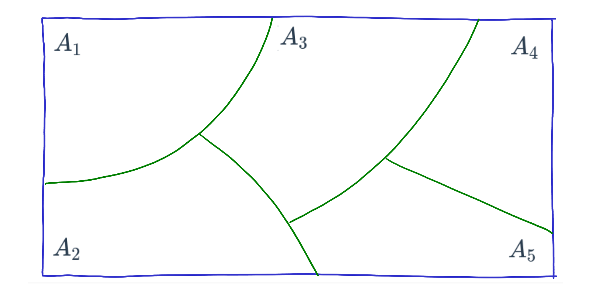
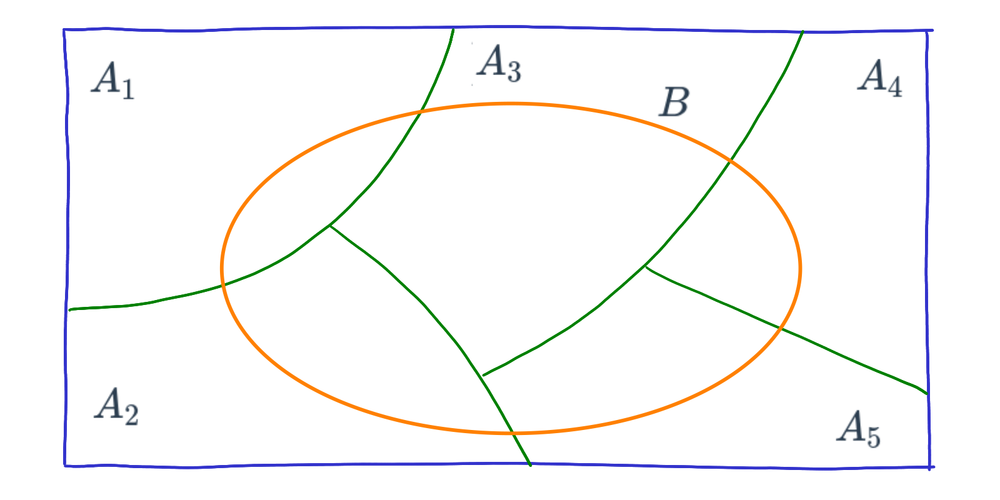
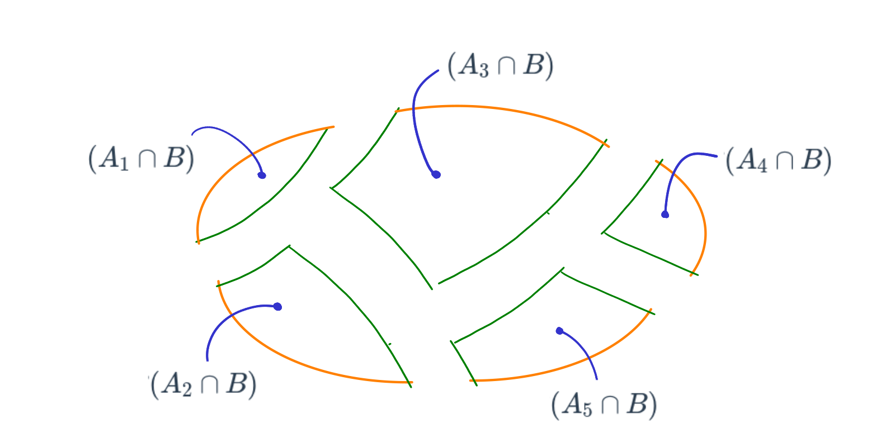
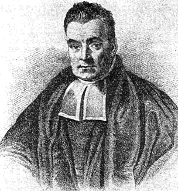

```{r setup, include=FALSE}
knitr::opts_chunk$set(echo = TRUE, message = FALSE, warning = FALSE, comment = NA, collapse = FALSE)
```

<br/>

Un médico sabe qué tan bien detecta el dengue una prueba rápida, pero lo que necesita saber frente a un paciente con resultado positivo es otra cosa: ¿qué tan probable es que tenga dengue? Un banco sabe cómo pagan sus clientes cumplidos e incumplidos, pero quiere saber qué tan probable es que un cliente nuevo incumpla, dado cómo paga.

El **teorema de Bayes** responde este tipo de preguntas: permite **actualizar** una probabilidad cuando se obtiene información nueva. Para usarlo primero se necesita la **ley de probabilidad total**. Los bloques de código se ejecutan en orden.

<br/>

## <span style="color:#034a94">**¿Qué es una partición?**</span>

Los eventos $A_1, A_2, \ldots, A_k$ forman una **partición** del espacio muestral si cumplen dos condiciones:

- **No se cruzan:** son mutuamente excluyentes; ningún resultado está en dos de ellos.
- **Lo cubren todo:** su unión es el espacio muestral; todo resultado está en alguno de ellos.

En palabras, cada resultado pertenece a uno y solo uno de los eventos. La figura muestra una partición del espacio muestral en cinco eventos, $A_1$ a $A_5$: las piezas no se superponen y juntas llenan todo el rectángulo.

```{r, echo=FALSE, out.width="60%", fig.align="center", fig.cap="Partición del espacio muestral en cinco eventos.", fig.alt="Rectángulo dividido por líneas verdes en cinco regiones marcadas A1, A2, A3, A4 y A5"}

```

Por ejemplo, los medios de pago efectivo, tarjeta de crédito y tarjeta débito forman una partición si todo pago se hace con uno solo de ellos.

<br/>

## <span style="color:#034a94">**¿Qué es la ley de probabilidad total?**</span>

Suponga que sobre la partición anterior se dibuja un evento $B$, como la elipse naranja de la figura. Las líneas de la partición dividen a $B$ en cinco pedazos.

```{r, echo=FALSE, out.width="60%", fig.align="center", fig.cap="Evento B sobre la partición del espacio muestral.", fig.alt="El rectángulo dividido en cinco regiones, con una elipse naranja marcada B que atraviesa las cinco"}

```

Cada pedazo es la intersección de $B$ con uno de los eventos de la partición: $A_1 \cap B$, $A_2 \cap B$, y así hasta $A_5 \cap B$.

```{r, echo=FALSE, out.width="60%", fig.align="center", fig.cap="El evento B separado en sus intersecciones con cada evento de la partición.", fig.alt="La elipse B separada en cinco pedazos, cada uno señalado con su nombre, de A1 ∩ B a A5 ∩ B"}

```

Como los pedazos no se superponen y juntos forman $B$, la probabilidad de $B$ es la suma de las probabilidades de los pedazos:

$$
P(B) = P(A_1 \cap B) + P(A_2 \cap B) + P(A_3 \cap B) + P(A_4 \cap B) + P(A_5 \cap B)
$$

Si se escribe cada pedazo con la regla de la multiplicación, $P(A_i \cap B) = P(A_i)\,P(B \mid A_i)$, se obtiene la **ley de probabilidad total**. Para una partición de $k$ eventos:

$$
P(B) = P(A_1)\,P(B \mid A_1) + P(A_2)\,P(B \mid A_2) + \cdots + P(A_k)\,P(B \mid A_k)
$$

En un diagrama de árbol, es la suma de todos los caminos que terminan en $B$.

<br/>

### <span style="color:#034a94">**Ejemplo: pagos en la universidad**</span>

El departamento de crédito de una universidad informa que el 30 % de los pagos se hace en efectivo ($E$), el 40 % con tarjeta de crédito ($TC$) y el 30 % con tarjeta débito ($TD$). Además, son mayores de 500 mil pesos el 20 % de los pagos en efectivo, el 70 % de los pagos con crédito y el 80 % de los pagos con débito. Sea $M$: el pago es mayor de 500 mil pesos.

| Medio de pago | $P(\text{medio})$ | $P(M \mid \text{medio})$ | $P(\text{medio} \cap M)$ |
|:--------------|:-----------------:|:------------------------:|:------------------------:|
| Efectivo | 0.30 | 0.20 | 0.06 |
| Tarjeta de crédito | 0.40 | 0.70 | 0.28 |
| Tarjeta débito | 0.30 | 0.80 | 0.24 |
| **Total** | **1.00** | | **0.58** |

El diagrama de árbol muestra la misma información. Las primeras ramas tienen las probabilidades de cada medio de pago y las segundas, las probabilidades condicionales del monto. Al final de cada camino está la probabilidad conjunta. Los tres caminos que terminan en $M$ están resaltados: su suma es $P(M)$.

```{r, fig.width=8, fig.height=5.2, fig.cap="Diagrama de árbol de los pagos. M: el pago es mayor de 500 mil pesos; Mᶜ: es de 500 mil o menos.", fig.alt="Árbol con tres ramas iniciales, Efectivo 0.30, Crédito 0.40 y Débito 0.30; cada una se divide en M y M complemento con sus probabilidades condicionales; a la derecha, las seis probabilidades conjuntas, con las de M en negrilla", out.width="100%"}
par(mar = c(0.5, 0.5, 0.5, 0.5))
plot(0, 0, type = "n", xlim = c(0, 10), ylim = c(0, 12), axes = FALSE, xlab = "", ylab = "")

# primeras ramas: medio de pago
y_medio <- c(10, 6, 2)
segments(0.5, 6, 3.3, y_medio, col = "#034A94", lwd = 2)
text(1.7, c(8.6, 6.4, 3.4), c("0.30", "0.40", "0.30"), col = "#034A94")
text(4.1, y_medio, c("Efectivo", "Crédito", "Débito"), font = 2)

# segundas ramas: monto, dado el medio de pago
y_monto <- c(11, 9, 7, 5, 3, 1)
segments(4.9, rep(y_medio, each = 2), 7, y_monto, col = "#C0392B", lwd = 2)
text(5.8, y_monto + c(0.4, -0.4), c("0.20", "0.80", "0.70", "0.30", "0.80", "0.20"), col = "#C0392B")
text(7.5, y_monto, rep(c("M", "Mᶜ"), 3))

# probabilidades conjuntas; en negrilla, los caminos que terminan en M
text(9.2, y_monto, c("0.06", "0.24", "0.28", "0.12", "0.24", "0.06"), font = rep(c(2, 1), 3))
```

La probabilidad de que un pago sea mayor de 500 mil pesos es la suma de la última columna:

$$
P(M) = 0.30 \times 0.20 + 0.40 \times 0.70 + 0.30 \times 0.80 = 0.58
$$

En **R**, se guardan las probabilidades en vectores y se multiplican elemento por elemento:

```{r}
medio <- c(Efectivo = 0.30, Credito = 0.40, Debito = 0.30)   # P(medio)
mayor <- c(Efectivo = 0.20, Credito = 0.70, Debito = 0.80)   # P(M | medio)
conjunta <- medio * mayor                                     # P(medio y M)
conjunta
sum(conjunta)                                                 # P(M), ley de probabilidad total
```

<br/>

## <span style="color:#034a94">**¿Qué dice el teorema de Bayes?**</span>

Thomas Bayes (c. 1701-1761) fue un matemático y ministro presbiteriano inglés. Su resultado más conocido, publicado después de su muerte, es el teorema que lleva su nombre: una forma de **actualizar** una probabilidad a partir de información nueva.

```{r, echo=FALSE, out.width="25%", fig.align="center", fig.cap="Retrato atribuido a Thomas Bayes.", fig.alt="Retrato antiguo de un hombre con peluca y ropa oscura"}

```

El teorema invierte la condición: a partir de $P(B \mid A_i)$ calcula $P(A_i \mid B)$.

$$
P(A_i \mid B) = \frac{P(A_i)\,P(B \mid A_i)}{P(B)}
$$

El denominador, $P(B)$, se calcula con la ley de probabilidad total. Sus partes tienen nombre propio:

| Término | Nombre | Significado |
|:--------|:-------|:------------|
| $P(A_i)$ | Probabilidad **a priori** | Lo que se sabe antes de observar $B$ |
| $P(B \mid A_i)$ | Verosimilitud | Qué tan probable es observar $B$ si ocurrió $A_i$ |
| $P(A_i \mid B)$ | Probabilidad **a posteriori** | Lo que se sabe después de observar $B$ |

En el ejemplo de los pagos, si se sabe que un pago fue mayor de 500 mil pesos, ¿cuál es la probabilidad de que se haya hecho con cada medio? Se divide cada probabilidad conjunta por $P(M) = 0.58$:

```{r}
posterior <- conjunta / sum(conjunta)
round(posterior, 4)
```

| Medio de pago | A priori | A posteriori, dado que el pago es mayor de 500 mil |
|:--------------|:--------:|:--------------------------------------------------:|
| Efectivo | 0.30 | 0.1034 |
| Tarjeta de crédito | 0.40 | 0.4828 |
| Tarjeta débito | 0.30 | 0.4138 |

Antes de conocer el monto, el efectivo y el débito eran igual de probables. Saber que el pago es alto baja mucho la probabilidad del efectivo y sube la de las tarjetas. Las probabilidades a posteriori también suman 1.

<br/>

### <span style="color:#034a94">**Ejemplo: ¿quién olvidó la fecha?**</span>

En una fábrica, cuatro operarios ponen la fecha de vencimiento en los paquetes. Juan etiqueta el 40 % de los paquetes y falla en uno de cada 200; Luis etiqueta el 30 % y falla en uno de cada 100; María, el 15 % y falla en uno de cada 90; y Santiago, el 15 % y falla en uno de cada 200. Un cliente encuentra un paquete sin fecha. ¿Quién es el responsable más probable?

```{r}
etiqueta <- c(Juan = 0.40, Luis = 0.30, Maria = 0.15, Santiago = 0.15)   # a priori
falla    <- c(Juan = 1/200, Luis = 1/100, Maria = 1/90, Santiago = 1/200) # P(sin fecha | operario)
conjunta_op <- etiqueta * falla
sum(conjunta_op)                              # P(sin fecha)
round(conjunta_op / sum(conjunta_op), 4)      # a posteriori
```

Aunque Juan etiqueta más paquetes, el responsable más probable es Luis, con 0.4045: etiqueta muchos paquetes y falla el doble que Juan.

<br/>

## <span style="color:#034a94">**¿Cómo se interpreta una prueba diagnóstica?**</span>

Una prueba diagnóstica se describe con dos probabilidades:

- **Sensibilidad:** la probabilidad de que la prueba salga positiva si la persona está enferma, $P(+ \mid D)$.
- **Especificidad:** la probabilidad de que la prueba salga negativa si la persona está sana, $P(- \mid D^c)$.

Pero frente a un resultado positivo, la pregunta es otra: ¿qué tan probable es que la persona esté enferma? Esa probabilidad, $P(D \mid +)$, se llama **valor predictivo positivo** y se calcula con el teorema de Bayes.

Suponga una prueba rápida de dengue con sensibilidad 0.91 y especificidad 0.96, valores reportados por Mata et al. (2020). Una forma sencilla de razonar es imaginar **10 000 personas** con fiebre en una zona donde el 10 % tiene dengue:

| | Prueba positiva | Prueba negativa | Total |
|:--|:--:|:--:|:--:|
| Con dengue | $1000 \times 0.91 = 910$ | 90 | 1 000 |
| Sin dengue | $9000 \times 0.04 = 360$ | 8 640 | 9 000 |
| **Total** | **1 270** | **8 730** | **10 000** |

De las 1 270 personas con prueba positiva, 910 tienen dengue:

$$
P(D \mid +) = \frac{910}{1270} = 0.717
$$

```{r}
sens <- 0.91
espec <- 0.96
prev <- 0.10                               # proporción de personas con dengue

prev * sens / (prev * sens + (1 - prev) * (1 - espec))   # teorema de Bayes
```

<br/>

### <span style="color:#034a94">**¿Cambia el resultado si cambia la proporción de enfermos?**</span>

Sí, y mucho. La sensibilidad y la especificidad son propiedades de la prueba, pero el valor predictivo positivo depende también de qué tan común es la enfermedad, llamada **prevalencia**:

```{r}
prev <- c(0.01, 0.05, 0.10, 0.30)
vpp <- prev * sens / (prev * sens + (1 - prev) * (1 - espec))
data.frame(prevalencia = prev, VPP = round(vpp, 3))
```

```{r, fig.width=8, fig.height=4.2, fig.cap="Valor predictivo positivo de una prueba con sensibilidad 0.91 y especificidad 0.96, según la prevalencia.", fig.alt="Curva azul que sube rápido desde 0, pasa por 0.72 en una prevalencia de 0.1 y se acerca a 1 a partir de una prevalencia de 0.4", out.width="100%"}
prev_graf <- seq(0.001, 0.6, by = 0.001)
vpp_graf <- prev_graf * sens / (prev_graf * sens + (1 - prev_graf) * (1 - espec))
plot(prev_graf, vpp_graf, type = "l", lwd = 2, col = "#034A94", ylim = c(0, 1),
     xlab = "Prevalencia", ylab = "P(dengue | prueba positiva)")
abline(v = 0.10, lty = 2, col = "gray50")
```

Con la misma prueba, si solo el 1 % de las personas tiene dengue, apenas el 18.7 % de los positivos está realmente enfermo: la mayoría de los positivos son falsos positivos entre las muchas personas sanas.

<div class="content-box-gray">
### <span style="color:#686868">**No olvidar la probabilidad a priori**</span>

Un error común es creer que si la prueba acierta en el 91 % de los enfermos, un positivo indica un 91 % de probabilidad de estar enfermo. Esa conclusión ignora la prevalencia, que es la probabilidad a priori. El teorema de Bayes la tiene en cuenta.
</div>

<br/>

## <span style="color:#034a94">**Errores frecuentes**</span>

| Problema | Causa | Solución |
|:---------|:------|:---------|
| Se toma la sensibilidad como si fuera $P(D \mid +)$ | Se intercambió la condición | Aplicar el teorema de Bayes |
| Las probabilidades a posteriori no suman 1 | El denominador no incluye todos los casos | Calcular $P(B)$ con la ley de probabilidad total |
| Se ignora la prevalencia | Se olvidó la probabilidad a priori | Construir la tabla de 10 000 personas |
| Los eventos usados no forman una partición | Se cruzan o falta alguno | Revisar que cada resultado esté en uno y solo uno |

<br/>

## <span style="color:#034a94">**Retos**</span>

<div class="content-box-yellow">
### <span style="color:#686868">**Reto 1. Pagos menores**</span>

En el ejemplo de los pagos, calcule la probabilidad de que un pago sea de 500 mil pesos o menos. Si un pago fue de 500 mil o menos, ¿cuál es el medio de pago más probable?

<details>
<summary>Ver solución</summary>

```{r}
menor <- 1 - mayor                      # P(500 mil o menos | medio)
conjunta_menor <- medio * menor
sum(conjunta_menor)                     # 0.42, también es 1 - 0.58
round(conjunta_menor / sum(conjunta_menor), 4)
```

El efectivo es el más probable, con 0.5714.

</details>
</div>

<div class="content-box-yellow">
### <span style="color:#686868">**Reto 2. ¿Estudió?**</span>

El 70 % de los estudiantes de un curso estudia para el examen. De quienes estudian aprueba el 90 %, y de quienes no estudian, el 40 %. Si un estudiante aprobó, ¿cuál es la probabilidad de que haya estudiado?

<details>
<summary>Ver solución</summary>

$P(\text{aprueba}) = 0.7 \times 0.9 + 0.3 \times 0.4 = 0.75$ y $P(\text{estudió} \mid \text{aprueba}) = 0.63 / 0.75 = 0.84$.

```{r}
estudia <- c(Si = 0.7, No = 0.3)
aprueba <- c(Si = 0.9, No = 0.4)
(estudia * aprueba) / sum(estudia * aprueba)
```

</details>
</div>

<div class="content-box-yellow">
### <span style="color:#686868">**Reto 3. Resultado negativo**</span>

Con la prueba de dengue y una prevalencia del 10 %, ¿cuál es la probabilidad de que una persona con prueba negativa tenga dengue? Use la tabla de 10 000 personas.

<details>
<summary>Ver solución</summary>

De las 8 730 personas con prueba negativa, 90 tienen dengue: $90 / 8730 = 0.0103$.

```{r}
prev <- 0.10
prev * (1 - sens) / (prev * (1 - sens) + (1 - prev) * espec)
```

Un resultado negativo deja una probabilidad de dengue cercana al 1 %.

</details>
</div>

<div class="content-box-yellow">
### <span style="color:#686868">**Reto 4. En plena epidemia**</span>

Durante una epidemia, el 30 % de las personas con fiebre que consultan tiene dengue. Construya la tabla de 10 000 personas y calcule $P(D \mid +)$. Compare con el resultado para una prevalencia del 10 %.

<details>
<summary>Ver solución</summary>

Hay 3 000 personas con dengue, de las cuales 2 730 dan positivo, y 7 000 sin dengue, de las cuales 280 dan positivo. Entonces $P(D \mid +) = 2730 / 3010 = 0.907$.

```{r}
prev <- 0.30
prev * sens / (prev * sens + (1 - prev) * (1 - espec))
```

Con la misma prueba, el valor predictivo positivo sube de 0.717 a 0.907 porque la enfermedad es más común.

</details>
</div>

<br/>

## <span style="color:#034a94">**Libros y recursos**</span>

### <span style="color:#034a94">**Libros para leer o descargar gratis**</span>

- OpenStax. [*Introducción a la estadística*](https://openstax.org/books/introducci%C3%B3n-estad%C3%ADstica/pages/3-introduccion), capítulo 3, Temas de probabilidad. En español. La sección 3.5 trata los diagramas de árbol, que ayudan a organizar los problemas de este tema.
- Grinstead, C. M. y Snell, J. L. (1997). [*Introduction to Probability*](https://chance.dartmouth.edu/book.html) (2.ª ed.). American Mathematical Society. Se descarga en PDF. La sección 4.1 trata el teorema de Bayes, con un ejemplo de pruebas diagnósticas.
- Blitzstein, J. K. y Hwang, J. (2019). [*Introduction to Probability*](http://probabilitybook.net) (2.ª ed.). Chapman & Hall/CRC. Versión gratuita para leer en línea, para quien quiera profundizar. El capítulo 2 trata el teorema de Bayes y la ley de probabilidad total.

### <span style="color:#034a94">**Otros libros**</span>

- Walpole, R. E., Myers, R. H., Myers, S. L. y Ye, K. (2012). *Probabilidad y estadística para ingeniería y ciencias* (9.ª ed.). Pearson. El capítulo 2 trata la regla de eliminación, como llama a la ley de probabilidad total, y el teorema de Bayes.

<br/>

## <span style="color:#034a94">**Referencias**</span>

- Mata, V. E., Andrade, C. A. F. y Passos, S. R. L. (2020). [Rapid immunochromatographic tests for the diagnosis of dengue: a systematic review and meta-analysis](https://scielosp.org/pdf/csp/2020.v36n6/e00225618/en). *Cadernos de Saúde Pública*, 36(6), e00225618.
- OpenStax. *Introducción a la estadística*. Rice University.
- Walpole, R. E., Myers, R. H., Myers, S. L. y Ye, K. (2012). *Probabilidad y estadística para ingeniería y ciencias* (9.ª ed.). Pearson.

<br/>

*Última revisión: 7 de noviembre de 2026.*

<br/><br/>
