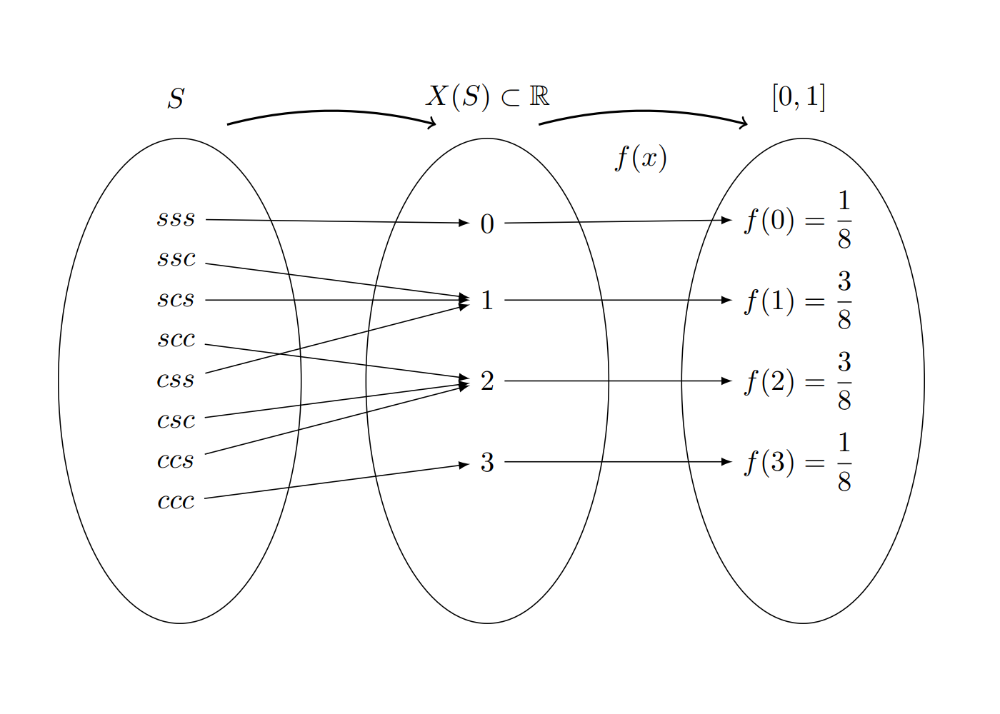

```{r setup, include=FALSE}
knitr::opts_chunk$set(echo = TRUE, message = FALSE, warning = FALSE, comment = NA, collapse = FALSE)
```

<br/>

¿Cuánto tiempo tarda un estudiante en llegar a la universidad? ¿Cuántas botellas de agua venderá la cafetería esta semana? ¿Cuántos mensajes llegarán hoy por WhatsApp? ¿Cuánto durará la batería de un celular? Ninguna de estas preguntas tiene una única respuesta: el resultado cambia de una vez a otra.

Una **variable aleatoria** describe con un número el resultado de un experimento aleatorio. Esta página presenta la definición, los dos tipos de variables aleatorias, discretas y continuas, y las funciones que describen cómo se reparte la probabilidad entre sus valores. Los bloques de código se ejecutan en orden.

<br/>

## <span style="color:#034a94">**¿Qué es una variable aleatoria?**</span>

Una **variable aleatoria** $X$ es una regla que asigna un número a cada resultado del espacio muestral. El conjunto de números que puede tomar se llama **rango** de la variable y se escribe $R_X$.

Se lanza una moneda balanceada tres veces y se registra el orden de caras ($c$) y sellos ($s$). El espacio muestral tiene 8 resultados:

$$
\Omega = \{sss,\ ssc,\ scs,\ scc,\ css,\ csc,\ ccs,\ ccc\}
$$

Si $X$ es el **número de caras**, la variable asigna a cada resultado un número entre 0 y 3, así que $R_X = \{0, 1, 2, 3\}$. La figura muestra la regla: cada resultado del espacio muestral va a un valor de $X$, y cada valor de $X$ recibe una probabilidad.

```{r, echo=FALSE, out.width="70%", fig.align="center", fig.cap="Relación entre el espacio muestral, el rango de la variable aleatoria y su función de probabilidad.", fig.alt="Tres óvalos. El primero tiene los 8 resultados de lanzar tres monedas; flechas los llevan a los valores 0, 1, 2 y 3 del segundo óvalo; de ahí, flechas llevan a las probabilidades 1/8, 3/8, 3/8 y 1/8 del tercero"}

```

Como los 8 resultados son igualmente probables, la probabilidad de cada valor de $X$ se obtiene contando sus resultados:

| Valor de $X$ | Resultados | $P(X = x)$ |
|:------------:|:-----------|:----------:|
| 0 | $sss$ | 1/8 |
| 1 | $ssc$, $scs$, $css$ | 3/8 |
| 2 | $scc$, $csc$, $ccs$ | 3/8 |
| 3 | $ccc$ | 1/8 |

En **R**, se construye el espacio muestral con `expand.grid()`, se cuenta el número de caras de cada resultado con `rowSums()` y se tabula:

```{r}
monedas <- expand.grid(m1 = c("c", "s"), m2 = c("c", "s"), m3 = c("c", "s"))
X <- rowSums(monedas == "c")     # número de caras de cada resultado
table(X) / nrow(monedas)         # P(X = x)
```

<br/>

## <span style="color:#034a94">**¿Qué tipos de variables aleatorias hay?**</span>

| Tipo | Valores que toma | Cómo surge | Ejemplos |
|:-----|:-----------------|:-----------|:---------|
| **Discreta** | Valores que se pueden contar: $0, 1, 2, \ldots$ | De un **conteo**: "número de..." | Número de llamadas a un conmutador en un día, número de hijos de una familia, número de quejas en una sucursal bancaria |
| **Continua** | Cualquier valor de un intervalo | De una **medición** | Tiempo que tarda un examen, peso de un recién nacido, diámetro de una perforación, contenido de azúcar de un refresco |

<br/>

## <span style="color:#034a94">**¿Cómo se describe una variable discreta?**</span>

### <span style="color:#034a94">**Función de probabilidad**</span>

La **función de probabilidad** de una variable discreta asigna a cada valor $x$ su probabilidad, $f(x) = P(X = x)$. Cumple dos condiciones:

1. Ninguna probabilidad es negativa: $f(x) \geq 0$.
2. Las probabilidades de todos los valores suman 1: $\sum_x f(x) = 1$.

En el ejemplo de las monedas, $1/8 + 3/8 + 3/8 + 1/8 = 1$.

<br/>

### <span style="color:#034a94">**Función de distribución acumulada**</span>

Sea $X$ una **variable aleatoria discreta** con función de probabilidad $f_{X}(x)$. La **función de distribución acumulada** $F_{X}(x)$ se define como la probabilidad de que la variable aleatoria tome un valor menor o igual que $x$:

$F_{X}(x) = P(X \leq x) = \sum_{t \leq x} f_{X}(t)$

Propiedades de la función de distribución acumulada:

- **Monotonía:** $F_{X}(x)$ es una función no decreciente, es decir, si $a < b$, entonces $F_{X}(a) \leq F_{X}(b)$.
- **Rangos extremos:** $\lim_{x \to -\infty} F_{X}(x) = 0$ y $\lim_{x \to \infty} F_{X}(x) = 1$.
- **Incrementos por saltos:** En el caso discreto, $F_{X}(x)$ es una función escalonada que aumenta en los valores donde $X$ tiene probabilidad no nula.

Esta función es fundamental para caracterizar la distribución de probabilidad de variables discretas y para calcular probabilidades en intervalos específicos. Con $F_{X}(x)$ se calculan, por ejemplo, las siguientes probabilidades:

| Probabilidad | Cómo se calcula |
|:-------------|:----------------|
| $P(X \leq a)$ | $F(a)$ |
| $P(X > a)$ | $1 - F(a)$ |
| $P(a < X \leq b)$ | $F(b) - F(a)$ |

<br/>

### <span style="color:#034a94">**Ejemplo: reservas en un restaurante**</span>

El restaurante **Asados y algo más** solo atiende con reserva y recibe 20 reservas por noche. Según sus registros de los últimos años, el 30 % de las personas que reservan no asisten, mientras que el 70 % sí asiste. Al dueño le interesa la variable

<center>$X$: número de personas que asisten en una noche,</center>

porque de ella dependen la comida que debe preparar y los meseros que debe contratar. $X$ es una variable **discreta**: puede tomar los valores $0, 1, 2, \ldots, 20$.

**¿Por qué el modelo binomial?** La situación cumple cuatro condiciones:

1. Hay un número fijo de **ensayos**: las 20 reservas.
2. Cada ensayo tiene solo dos resultados: la persona **asiste** (éxito) o **no asiste** (fracaso).
3. La probabilidad de éxito es la misma en todos los ensayos: $p = 0.7$.
4. Los ensayos son **independientes**: que una persona asista no cambia la probabilidad de que asista otra.

Cuando se cumplen estas condiciones, el número de éxitos sigue una **distribución binomial** con $n = 20$ y $p = 0.7$, y su función de probabilidad es

$$
f_X(x) = \binom{20}{x}(0.7)^{x}(0.3)^{20 - x}, \qquad x = 0, 1, \ldots, 20
$$

Cada parte de la fórmula tiene un significado:

- $(0.7)^x$ es la probabilidad de que asistan $x$ personas determinadas.
- $(0.3)^{20 - x}$ es la probabilidad de que las otras $20 - x$ no asistan.
- $\binom{20}{x}$ cuenta de cuántas formas se puede escoger **cuáles** de las 20 personas son las que asisten.

**Un cálculo a mano.** La probabilidad de que asistan exactamente 14 personas es

$$
f_X(14) = \binom{20}{14}(0.7)^{14}(0.3)^{6} = 38\,760 \times 0.006782 \times 0.000729 = 0.1916
$$

Hay 38 760 formas de escoger a las 14 personas que asisten, y cada una de esas formas tiene probabilidad $0.006782 \times 0.000729$. En **R** se puede reproducir cada parte:

```{r}
choose(20, 14)                          # formas de escoger a las 14 que asisten
0.7^14 * 0.3^6                          # probabilidad de una de esas formas: 4.94e-06 = 0.00000494
choose(20, 14) * 0.7^14 * 0.3^6         # f(14)
```

**Toda la distribución en R.** Calcular a mano las 21 probabilidades sería largo. **R** lo hace con dos funciones, que se estudian en detalle en [Modelos discretos](recurso203.html):

- `dbinom(x, size, prob)` calcula la función de probabilidad, $f_X(x) = P(X = x)$.
- `pbinom(x, size, prob)` calcula la función de distribución acumulada, $F_X(x) = P(X \leq x)$.

El argumento `size` es el número de ensayos ($n = 20$) y `prob`, la probabilidad de éxito ($p = 0.7$). El código siguiente:

1. Crea el vector `x` con los valores posibles, de 0 a 20.
2. Calcula $f_X(x)$ y $F_X(x)$ para todos esos valores a la vez.
3. Comprueba que las 21 probabilidades suman 1.
4. Muestra la tabla con los valores de 10 a 20, redondeados a cuatro decimales. Las filas 11 a 21 de la tabla corresponden a $x = 10, \ldots, 20$, porque la primera fila es $x = 0$.

```{r}
x  <- 0:20
fx <- dbinom(x, size = 20, prob = 0.7)   # f(x) = P(X = x)
Fx <- pbinom(x, size = 20, prob = 0.7)   # F(x) = P(X <= x)
sum(fx)                                  # las probabilidades suman 1
round(data.frame(x, fx, Fx)[11:21, ], 4) # valores de 10 a 20
```

**Cómo leer la tabla.** Cada fila tiene un valor de $x$, su probabilidad $f_X(x)$ y la probabilidad acumulada $F_X(x)$:

- La columna `fx` muestra que los valores más probables están alrededor de 14: $f_X(14) = 0.1916$ es la probabilidad más alta. Tiene sentido, porque el 70 % de 20 es 14.
- La columna `Fx` se obtiene **sumando** la columna `fx` hasta cada fila. Por ejemplo, $F_X(14) = F_X(13) + f_X(14) = 0.3920 + 0.1916 = 0.5836$.
- Los valores de 0 a 9 no aparecen porque sus probabilidades son muy pequeñas: entre todos suman $F_X(9) = 0.0171$. La probabilidad de que no asista nadie, $f_X(0)$, es menor que una en diez mil millones.
- La última fila confirma que $F_X(20) = 1$: es seguro que asistan 20 personas o menos.

La figura muestra las dos funciones. En la de la izquierda, la altura de cada barra es $f_X(x)$. En la de la derecha, cada escalón sube exactamente la altura de la barra correspondiente.

```{r, fig.width=9, fig.height=3.8, fig.cap="Función de probabilidad (izquierda) y función de distribución acumulada (derecha) del número de personas que asisten.", fig.alt="A la izquierda, barras naranjas con forma de montaña, con la más alta en 14. A la derecha, una escalera azul que sube desde 0 cerca de x = 9 hasta 1 en x = 20", out.width="100%"}
par(mfrow = c(1, 2), mar = c(4.5, 4.5, 1, 1))
barplot(fx, names.arg = x, col = "#FF7F00", ylim = c(0, 0.2),
        xlab = "Número de personas que asisten (x)", ylab = "f(x)")
plot(stepfun(x, c(0, Fx)), verticals = FALSE, pch = 19, col = "#034A94",
     xlim = c(0, 20), ylim = c(0, 1), main = "",
     xlab = "Número de personas que asisten (x)", ylab = "F(x)")
```

Algunas preguntas que se responden con estas funciones:

- **¿Qué tan probable es que asistan exactamente 14 personas?** $f(14) = 0.1916$.
- **¿Qué tan probable es que asistan 14 o menos?** $F(14) = 0.5836$.
- **¿Qué tan probable es que asistan más de 14?** $1 - F(14) = 0.4164$.
- **¿Qué tan probable es que asistan entre 12 y 16?** $F(16) - F(11) = 0.7796$. Se resta $F(11)$, y no $F(12)$, para incluir el 12.

```{r}
dbinom(14, 20, 0.7)                        # P(X = 14)
pbinom(14, 20, 0.7)                        # P(X <= 14)
1 - pbinom(14, 20, 0.7)                    # P(X > 14)
pbinom(16, 20, 0.7) - pbinom(11, 20, 0.7)  # P(12 <= X <= 16)
```

<br/>

## <span style="color:#034a94">**¿Cómo se describe una variable continua?**</span>

### <span style="color:#034a94">**Función de densidad**</span>

Una variable continua puede tomar infinitos valores, así que no se puede hacer una lista de probabilidades. Se usa una **función de densidad**, $f(x)$, cuya gráfica es una curva. La probabilidad de que $X$ esté entre $a$ y $b$ es el **área bajo la curva** entre esos dos valores:

$$
P(a \leq X \leq b) = \int_a^b f(x)\,dx
$$

La función de densidad cumple dos condiciones: nunca es negativa y el área total bajo la curva es 1.

<div class="content-box-gray">
### <span style="color:#686868">**La probabilidad de un valor exacto es cero**</span>

En una variable continua, $P(X = a) = 0$ para cualquier valor $a$: un solo punto no tiene área. Por eso, $P(a \leq X \leq b)$ y $P(a < X < b)$ son iguales. La altura $f(x)$ no es una probabilidad; solo el área lo es.
</div>

<br/>

### <span style="color:#034a94">**Función de distribución acumulada**</span>

Igual que en el caso discreto, $F(x) = P(X \leq x)$. Para una variable continua, es el área bajo la curva desde el extremo izquierdo hasta $x$. Es una curva suave que empieza en 0, nunca baja y llega a 1. Las reglas para calcular probabilidades son las mismas de la tabla anterior.

<br/>

### <span style="color:#034a94">**Ejemplo: tiempo hasta una reparación**</span>

Un fabricante de lavadoras sabe, por sus datos históricos, que el tiempo $X$ (en años) hasta que una lavadora necesita una reparación mayor tiene esta función de densidad:

$$
f(x) = \frac{1}{4}\,e^{-x/4}, \qquad x \geq 0
$$

y $f(x) = 0$ para $x < 0$. Al integrar se obtiene la función de distribución acumulada, $F(x) = 1 - e^{-x/4}$ para $x \geq 0$.

En **R**, la densidad se escribe como una función y la función `integrate()` calcula el área bajo la curva. Primero se comprueba que el área total es 1:

```{r}
f <- function(x) (1/4) * exp(-x/4)
integrate(f, lower = 0, upper = Inf)
```

¿Cuál es la probabilidad de que la lavadora necesite una reparación mayor **en los primeros 3 años**? Es el área entre 0 y 3:

$$
P(X \leq 3) = F(3) = 1 - e^{-3/4} = 0.5276
$$

¿Y **entre 2 y 5 años**?

$$
P(2 \leq X \leq 5) = F(5) - F(2) = e^{-2/4} - e^{-5/4} = 0.3200
$$

```{r}
F_acum <- function(x) 1 - exp(-x/4)
integrate(f, lower = 0, upper = 3)$value   # P(X <= 3) como área
F_acum(3)                                  # P(X <= 3) con la acumulada
F_acum(5) - F_acum(2)                      # P(2 <= X <= 5)
```

```{r, fig.width=9, fig.height=3.8, fig.cap="Función de densidad (izquierda), con el área sombreada que corresponde a P(2 ≤ X ≤ 5), y función de distribución acumulada (derecha) del tiempo hasta una reparación mayor.", fig.alt="A la izquierda, una curva naranja que baja desde 0.25 en x = 0, con el área entre 2 y 5 sombreada en azul. A la derecha, una curva azul que sube desde 0 y se acerca a 1", out.width="100%"}
par(mfrow = c(1, 2), mar = c(4.5, 4.5, 1, 1))
curve(f, from = 0, to = 20, col = "#FF7F00", lwd = 2, ylim = c(0, 0.26),
      xlab = "Tiempo (años)", ylab = "f(x)")
xs <- seq(2, 5, length.out = 100)
polygon(c(2, xs, 5), c(0, f(xs), 0), col = adjustcolor("#034A94", 0.4), border = NA)
curve(F_acum, from = 0, to = 20, col = "#034A94", lwd = 2, ylim = c(0, 1),
      xlab = "Tiempo (años)", ylab = "F(x)")
```

<br/>

## <span style="color:#034a94">**Errores frecuentes**</span>

| Problema | Causa | Solución |
|:---------|:------|:---------|
| Confundir una variable discreta con una continua | No se identificó si la variable cuenta o mide | Preguntar si surge de un conteo ("número de...") o de una medición |
| Leer la altura de la densidad como una probabilidad | En una variable continua, la probabilidad es un área | Calcular el área entre dos valores |
| $P(12 \leq X \leq 16)$ calculado como $F(16) - F(12)$ en una variable discreta | Se dejó por fuera el valor 12 | Usar $F(16) - F(11)$ |
| $P(X > a)$ calculado como $F(a)$ | Se confundió "mayor que" con "menor o igual que" | Usar $1 - F(a)$ |
| Las probabilidades de una tabla no suman 1 | Falta un valor o hay un error de cálculo | Revisar con `sum()` |

<br/>

## <span style="color:#034a94">**Retos**</span>

<div class="content-box-yellow">
### <span style="color:#686868">**Reto 1. ¿Discreta o continua?**</span>

Clasifique cada variable: (a) número de accidentes en una ciudad en un día; (b) tiempo de entrega de un domicilio; (c) número de huevos que produce una granja en un día; (d) proporción de cemento en una mezcla de concreto.

<details>
<summary>Ver solución</summary>

(a) y (c) son discretas, porque surgen de conteos. (b) y (d) son continuas, porque surgen de mediciones y pueden tomar cualquier valor de un intervalo.

</details>
</div>

<div class="content-box-yellow">
### <span style="color:#686868">**Reto 2. Suma de dos dados**</span>

Se lanzan dos dados y $X$ es la suma. Construya su función de probabilidad en **R** y calcule $P(X \leq 4)$ y $P(X > 9)$.

<details>
<summary>Ver solución</summary>

```{r}
dados <- expand.grid(d1 = 1:6, d2 = 1:6)
suma <- dados$d1 + dados$d2
fx_suma <- table(suma) / 36
round(fx_suma, 4)
mean(suma <= 4)   # P(X <= 4) = 6/36
mean(suma > 9)    # P(X > 9) = 6/36
```

</details>
</div>

<div class="content-box-yellow">
### <span style="color:#686868">**Reto 3. Reservas**</span>

En el ejemplo del restaurante, ¿cuál es la probabilidad de que asistan al menos 18 personas? ¿Y de que asistan menos de 10?

<details>
<summary>Ver solución</summary>

```{r}
1 - pbinom(17, 20, 0.7)   # P(X >= 18) = 1 - F(17)
pbinom(9, 20, 0.7)        # P(X < 10) = F(9)
```

La probabilidad de que asistan al menos 18 es 0.0355 y la de que asistan menos de 10, 0.0171.

</details>
</div>

<div class="content-box-yellow">
### <span style="color:#686868">**Reto 4. La lavadora**</span>

Con la densidad del ejemplo de las lavadoras, calcule la probabilidad de que una lavadora funcione más de 10 años sin una reparación mayor. ¿Antes de cuántos años la necesita la mitad de las lavadoras?

<details>
<summary>Ver solución</summary>

$P(X > 10) = 1 - F(10) = e^{-10/4} = 0.0821$. Para la mitad se busca $x$ tal que $F(x) = 0.5$: $1 - e^{-x/4} = 0.5$, de donde $x = 4 \ln 2 = 2.77$ años.

```{r}
1 - F_acum(10)
4 * log(2)
```

</details>
</div>

<br/>

## <span style="color:#034a94">**Libros y recursos**</span>

### <span style="color:#034a94">**Libros para leer o descargar gratis**</span>

- OpenStax. [*Introducción a la estadística*](https://openstax.org/books/introducci%C3%B3n-estad%C3%ADstica/pages/4-introduccion). En español. El capítulo 4 trata las variables aleatorias discretas y el capítulo 5, las continuas.
- Grinstead, C. M. y Snell, J. L. (1997). [*Introduction to Probability*](https://chance.dartmouth.edu/book.html) (2.ª ed.). American Mathematical Society. Se descarga en PDF. Los capítulos 1 y 2 tratan las distribuciones discretas y continuas.
- Blitzstein, J. K. y Hwang, J. (2019). [*Introduction to Probability*](http://probabilitybook.net) (2.ª ed.). Chapman & Hall/CRC. Versión gratuita para leer en línea, para quien quiera profundizar. Los capítulos 3 y 5 tratan las variables aleatorias discretas y continuas.

### <span style="color:#034a94">**Otros libros**</span>

- Walpole, R. E., Myers, R. H., Myers, S. L. y Ye, K. (2012). *Probabilidad y estadística para ingeniería y ciencias* (9.ª ed.). Pearson. El capítulo 3 trata las variables aleatorias y sus distribuciones.

<br/>

## <span style="color:#034a94">**Referencias**</span>

- OpenStax. *Introducción a la estadística*. Rice University.
- Walpole, R. E., Myers, R. H., Myers, S. L. y Ye, K. (2012). *Probabilidad y estadística para ingeniería y ciencias* (9.ª ed.). Pearson.
- R Core Team. Documentación de `dbinom()`, `pbinom()`, `integrate()` y `stepfun()`.

<br/>

*Última revisión: 7 de noviembre de 2026.*

<br/><br/>
